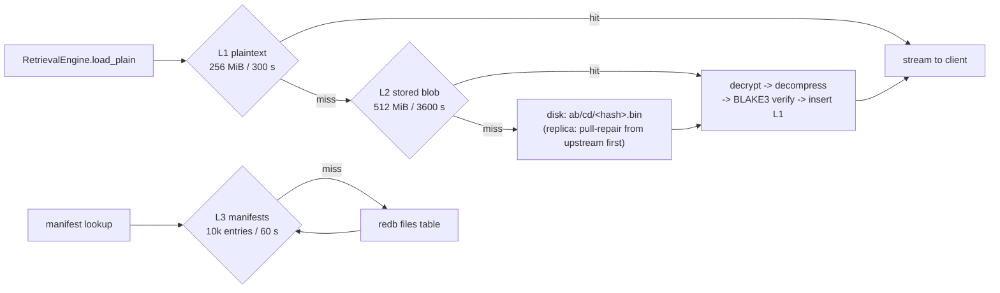

<!--
title: Caching
category: architecture
audience: developer
last_updated: 2026-11-10
-->

# Caching

This page documents the three-tier cache hierarchy — what each tier stores, how moka weighs and evicts entries, how read-ahead warms the tiers, and how hit rates are measured. Developers tuning read performance or reasoning about memory budgets should read it.

## Overview

The read path consults three independent moka caches before touching disk:

| Tier | Value shape | Default budget | TTL | Backed by |
|---|---|---|---|---|
| L1 | Plaintext chunk bytes, ready to stream | 256 MiB (`cache.l1_max_bytes` = 268435456) | 300 s (`l1_ttl_secs`) | `moka::future::Cache`, byte weigher |
| L2 | Stored blobs (compressed / encrypted), ready to decode | 512 MiB (`cache.l2_max_bytes` = 536870912) | 3600 s (`l2_ttl_secs`) | `moka::future::Cache`, byte weigher |
| L3 | `Arc<Manifest>` descriptors | 10 000 entries (`manifest_capacity`) | 60 s (`manifest_ttl_secs`) | `moka::future::Cache`, entry-count cap |

All three are built once at startup in `src/cache/` and shared through `AppState` by both the REST and gRPC listeners. The measured difference is substantial: full downloads run at 399 MB/s cold (disk → verify → decompress) versus 1107 MB/s warm on L1 plaintext hits, and an in-process 2 MiB retrieval through the cache hierarchy costs about 29 µs.


*Figure 1: The read path through the cache tiers. L1 hits return immediately; L2 hits pay decode once; disk loads are always verified before insertion.*

## How it works

### Byte weighers and eviction

L1 and L2 use byte weighers — each entry contributes `value.len() (min 1)` towards its tier's `max_capacity`, so a 256 MiB L1 holds a mix of chunk sizes rather than a fixed entry count. moka 0.12 (future feature) provides concurrent access with TinyLFU-style admission and TTL expiry; expired or evicted entries free their weighed bytes. L3 caps by entry count instead, because manifests vary little in size and the working set is "currently interesting files" rather than bytes.

Two details of the load path matter for correctness:

- **Single-flight loads.** L2 lookups use `try_get_with`, so concurrent requests for the same blob trigger exactly one disk load; the winner's result is shared. Errors are propagated, never cached.
- **Verified insertion only.** A plaintext chunk enters L1 only after BLAKE3 verification against `plain_hash` succeeds on the L2/disk path. A mismatch aborts with `HashMismatch`/`Corruption` (HTTP 500, gRPC `DATA_LOSS`) and increments `file_storage_hash_mismatch_total`.

### Read-ahead (N+1..N+4)

While streaming a file, the retrieval engine fires background prefetch tasks for chunks `N+1` through `N+4`, guarded by a 10-second timeout and skipped when `peek_blob` shows the blob is already in L2. Prefetch warms **L2 only**: it loads the stored blob bytes but deliberately leaves decryption and decompression on the hot path, so an encrypted workload does not pay decode work for chunks the client may never reach. Range requests prefetch within the sliced chunk list using the same window.

### Hit-rate accounting

Cache hits are counted in the Prometheus metric `file_storage_cache_hits_total{level}` with labels `l1` and `l2`; download duration is histogrammed by status and source in `file_storage_download_duration_seconds{status,source}`. The L3 manifest tier has no dedicated hit counter — its effectiveness shows up as lower `GET /files/:id/meta` latency and in the diagnostic stats exposed by the retrieval engine (L1/L2 entry counts and weighted sizes after `run_pending_tasks`). See [Monitoring](../operations/monitoring.md) for dashboard guidance.

### ETag / 304 is a separate layer

HTTP conditional requests are handled by the HTTP cache layer in `src/cache/http_cache.rs`, which is logically independent of the byte caches:

- The ETag is a strong validator: the quoted, 64-character lowercase-hex BLAKE3 digest of the original file content, so it is stable across chunking config changes and identical across replicas.
- `If-None-Match` is evaluated with full RFC semantics: `*`, comma-separated lists, quoted and unquoted forms, and weak `W/"…"` tags matched by opaque value. A match short-circuits to `304 Not Modified` with `ETag` and `Cache-Control: private, max-age=3600` — no manifest chunk loads, no cache tiers touched beyond L3.
- Successful downloads (200/206) also carry `ETag`, `Cache-Control`, `Content-Disposition`, and `X-Content-Hash` (the unquoted hash).

Because content is immutable once stored (same-name replacement creates a new `file_id`), a 304 is always safe for the lifetime of the manifest.

## Configuration

| Key | Default | Notes |
|---|---|---|
| `cache.l1_max_bytes` | `268435456` (256 MiB) | Plaintext chunk budget; raise for read-heavy, dedup-light workloads |
| `cache.l1_ttl_secs` | `300` | Short TTL keeps plaintext reclaims prompt |
| `cache.l2_max_bytes` | `536870912` (512 MiB) | Blob budget; the read-ahead target tier |
| `cache.l2_ttl_secs` | `3600` | Blobs are immutable, so a long TTL is safe |
| `cache.manifest_capacity` | `10000` | L3 entry cap |
| `cache.manifest_ttl_secs` | `60` | Deliberately short so soft-deletes propagate quickly |

Defaults total up to ~768 MiB of cache memory plus manifest storage; size your container accordingly. Overrides use the `FS_CACHE__*` environment convention (for example `FS_CACHE__L2_MAX_BYTES=1073741824`). Guidance on matching cache budgets to workload is in [Tuning](../performance/tuning.md). GC deletes and same-name replacement invalidate affected entries explicitly, but replicas that learn about deletes lazily rely on the 60 s manifest TTL.

## Examples

Reading a range across a cold cache exercises every tier once (see the sequence diagram in [Data Flow](./data-flow.md)); the second request to the same bytes should hit L1. Watch it happen:

```bash
# before: baseline
curl -s localhost:8080/metrics | grep cache_hits_total
# file_storage_cache_hits_total{level="l1"} 1042
# file_storage_cache_hits_total{level="l2"} 87

# request the same 1 MiB range twice
curl -s -o /dev/null -w '%{time_total}\n' -H "Authorization: Bearer $TOKEN" \
     -H 'Range: bytes=0-1048575' localhost:8080/api/v1/files/<id>/range
curl -s -o /dev/null -w '%{time_total}\n' -H "Authorization: Bearer $TOKEN" \
     -H 'Range: bytes=0-1048575' localhost:8080/api/v1/files/<id>/range

# after: l1 counter grows by one per served chunk
curl -s localhost:8080/metrics | grep cache_hits_total
```

A conditional download that stays cold:

```bash
ETAG=$(curl -s -D- -o /dev/null -H "Authorization: Bearer $TOKEN" \
       localhost:8080/api/v1/files/<id> | tr -d '\r' | awk -F'"' '/^[Ee][Tt]ag:/{print $2}')
curl -s -D- -o /dev/null -H "Authorization: Bearer $TOKEN" \
     -H "If-None-Match: \"$ETAG\"" localhost:8080/api/v1/files/<id>   # -> 304
```

## See also

- [Chunking](./chunking.md) — why chunk sizes determine cache-entry shapes
- [Data Flow](./data-flow.md) — the retrieval sequence diagrams with cache misses
- [Storage Layout](./storage-layout.md) — the blobs and manifests being cached
- [Benchmarks](../performance/benchmarks.md) — cold/warm download and range-slice numbers
- [Tuning](../performance/tuning.md) — cache sizing recipes
- [Monitoring](../operations/monitoring.md) — cache and download metrics in dashboards
