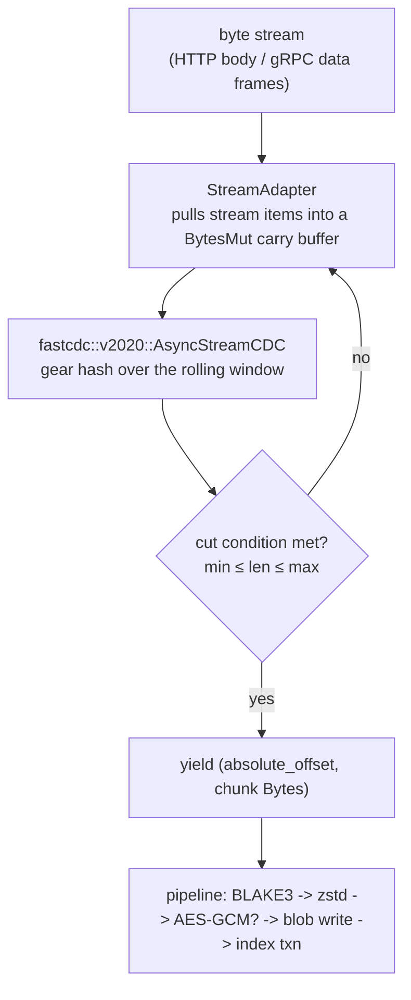

<!--
title: Chunking & Dedup
category: architecture
audience: developer
last_updated: 2026-11-10
-->

# Chunking & Dedup

This page explains how incoming bytes are cut into content-defined chunks, why chunk boundaries survive edits and different transport packetisation, and how that translates into deduplicated storage. Developers tuning dedup behaviour or debugging why two uploads dedup differently should read it.

## Overview

file-storage uses the FastCDC 2020 algorithm (the `fastcdc` crate, version 5, tokio feature) to split every upload into chunks of roughly 32 KiB, bounded between 8 KiB and 128 KiB by default. Each chunk is hashed with BLAKE3; the hash is the chunk's storage key, so identical content is stored once and reference-counted in the redb `chunks` table. Dedup is therefore an inline, exact-match operation — not a background scan — and re-uploading the same file reports `dedup_chunks = chunk_count` with zero new blob bytes.

## How it works

### FastCDC 2020 in brief

FastCDC is a content-defined chunker: it slides a gear-hash window over the byte stream and declares a cut point when the rolling hash matches a bitmask derived from the configured average size. Three parameters shape the cut-point distribution:

- **`min`** (default 8192) — no cut before this many bytes; protects against degenerate runs of tiny chunks.
- **`avg`** (default 32768) — the target expectation; the bitmask is tuned so the expected distance between cuts is 32 KiB.
- **`max`** (default 131072) — a forced cut ceiling; also the configuration cap is 16 MiB, with the constraint `min ≤ avg ≤ max`.

The 2020 refinement of the algorithm reworks the hash and mask handling so the scanner runs at memory bandwidth: the measured pure chunking rate on the benchmark rig is **1134 MB/s** (~1.1 GB/s) with 4 MiB input at 8/32/128 KiB — see [Benchmarks](../performance/benchmarks.md).


*Figure 1: `chunk_stream` in `src/core/chunker.rs`. The adapter bridges an arbitrary byte stream into tokio's `AsyncRead`; the chunker owns its carry buffer, so nothing upstream needs buffering whole files.*

### Boundaries are independent of packetisation

`AsyncStreamCDC` maintains its own rolling carry buffer, which gives the pipeline a property the REST and gRPC transports rely on: chunk boundaries depend only on content, never on how the bytes were packetised. The same 2 MB payload fed through `chunk_stream` in 1000-byte pieces and in 250 KB pieces produces byte-for-byte identical chunk hash sequences. This is asserted in unit tests (`boundaries_independent_of_packetisation`, `matches_single_pass_scanner`, `respects_min_and_max`), which compare streamed output against the synchronous single-pass scanner `chunk_slice`.

Consequences worth knowing:

- A multipart upload and a raw-body upload of the same bytes yield the same chunk set — dedup works across transport styles.
- A gRPC `Upload` stream (1 MiB client pieces) and a curl `--data-binary` upload dedup against each other.
- An upstream stream error aborts the scanner; buffered bytes that never reached a cut point are discarded with it, and the original `StorageError` is recovered from the `io::Error` wrapper.

### Tuning the chunk sizes

The `chunking.min` / `avg` / `max` keys trade dedup granularity against per-chunk metadata overhead:

| Profile | min / avg / max | Chunks per GiB (approx) | Dedup granularity | Metadata cost | When to use |
|---|---|---|---|---|---|
| Fine | 4096 / 16384 / 65536 | ~65 536 | Very high — small edits dedup well | More redb rows, larger manifests, slower index txns | Versioned text, VM disk deltas |
| Default | 8192 / 32768 / 131072 | ~32 768 | Balanced | Balanced | General-purpose workloads |
| Coarse | 16384 / 131072 / 1048576 | ~8 192 | Lower — only large identical regions dedup | Fewest rows, fastest commits | Large immutable media |
| Max cap | — / — / 16 777 216 | — | — | — | `max` may not exceed 16 MiB (validated at startup) |

Effects to expect when moving between profiles:

- Smaller `avg` raises the number of `chunks`-table rows and manifest entries per file; a 10 GiB file at the default 32 KiB average produces roughly 327 680 chunk refs.
- Larger `min` reduces pathological tiny-chunk runs (common in highly compressible data) at the cost of missing some short identical regions.
- `max` bounds the worst case for both streaming latency and the 8-wide pipeline's memory per in-flight chunk.

### Dedup mechanics

Dedup is bookkeeping on the `chunks` table, not a data-movement job:

| Concept | Where it lives | Behaviour |
|---|---|---|
| Storage hash | `ChunkRef.hash` / `chunks` key | The blob's name; plaintext BLAKE3, or `BLAKE3(tenant_id || plain_hash)` when encryption is on |
| Refcount | `ChunkMeta.refcount` | Incremented for every manifest reference in the upload's single index transaction; decremented when GC purges manifests |
| Dedup report | upload transaction return | One boolean per chunk: `true` = already present |
| Dedup metrics | Prometheus | `file_storage_dedup_hits_total`, `file_storage_dedup_bytes_saved_total` |

The expected dedup ratio follows from boundary stability. With fixed-size chunking, inserting one byte at offset *p* shifts every boundary after it — a 1 GiB file chunked at 64 KiB loses essentially all 16 384 chunks. With content-defined chunking, the re-synchronising gear hash confines the damage to the chunks overlapping the edit: for random insertions the expected number of disturbed chunks is proportional to the inserted length divided by the average chunk size (plus the two chunks at the seam), so a 4 KB edit into a 32 KiB-average file disturbs on the order of a couple of chunks out of tens of thousands. The measured behaviour matches: re-uploading the identical 512 KiB file yields `dedup_chunks = chunk_count`, and uniform content collapses to a single chunk per distinct hash.

Under encryption, random AES-GCM nonces make ciphertext-addressed dedup impossible, so the storage key is derived as `BLAKE3(tenant_id || plain_hash)`. Dedup stays exact within a tenant and is impossible across tenants by construction — the details and security reasoning are in [ADR 0007](./decisions/0007-encrypted-dedup-key-derivation.md).

## Configuration

| Key | Default | Constraint |
|---|---|---|
| `chunking.min` | `8192` | `min ≤ avg` |
| `chunking.avg` | `32768` | target expectation |
| `chunking.max` | `131072` | `avg ≤ max ≤ 16777216` (16 MiB) |

Override at startup, for example `FS_CHUNKING__AVG=65536`. There is no hot reload; changing chunking affects only new uploads (existing manifests keep their recorded chunk hashes, so reads are unaffected).

## Examples

The upload response reports dedup inline:

```bash
$ curl -s -X POST "localhost:8080/api/v1/files?name=daily.tar" \
       -H "Authorization: Bearer $TOKEN" -H 'Content-Type: application/octet-stream' \
       --data-binary @daily.tar
{
  "chunk_count": 2048,
  "dedup_chunks": 1984,
  "dedup_bytes": 63963136,
  "size": 67108864,
  "size_stored": 3145728,
  "content_hash": "…"
}
```

Here 1984 of 2048 chunks were already present — a typical nightly backup that changed ~3% of its blocks. The 64 unused bytes-per-chunk gap between `size` and `size_stored` reflects the 12 new chunks plus compression of the rest.

Verify chunk stability yourself from Rust with the synchronous helper used by the tests and benchmarks:

```rust
use file_storage::core::chunker::chunk_slice;

let cfg = ChunkingConfig { min: 8192, avg: 32768, max: 131072 };
let a = chunk_slice(&data, &cfg);                  // one pass
let b = chunk_slice(&data_with_append, &cfg);      // appended 100 bytes
// all chunks before the tail region keep identical hashes
```

## See also

- [ADR 0002 — FastCDC over fixed chunking](./decisions/0002-fastcdc-over-fixed-chunking.md) — the decision record
- [ADR 0007 — Encrypted dedup key derivation](./decisions/0007-encrypted-dedup-key-derivation.md) — dedup under encryption
- [Storage Layout](./storage-layout.md) — the `chunks` table and refcount encodings
- [Data Flow](./data-flow.md) — where chunking sits in the upload pipeline
- [Benchmarks](../performance/benchmarks.md) — measured chunking and pipeline throughput
- [Tuning](../performance/tuning.md) — sizing the pipeline and cache for your chunk profile
