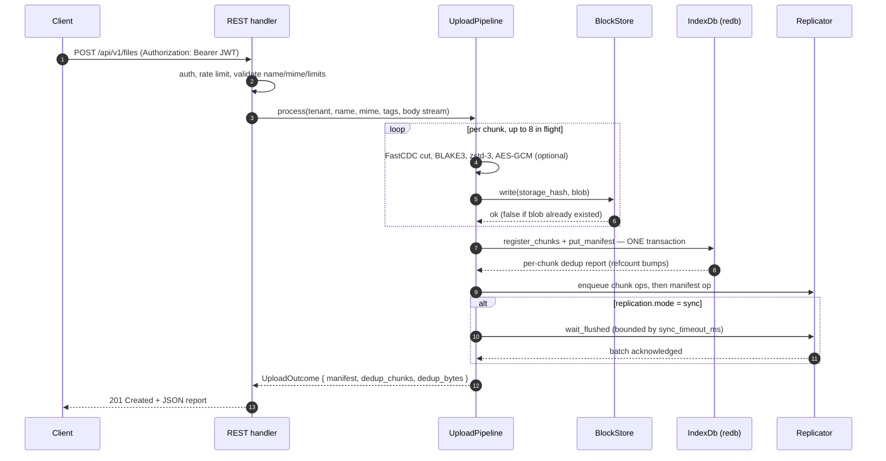

<!--
title: Data Flow
category: architecture
audience: developer
last_updated: 2026-11-10
-->

# Data Flow

This page walks bytes through the service end to end: the upload pipeline from HTTP request to `201 Created`, the retrieval path through the three cache tiers, and the sequence diagrams for normal uploads, dedup hits, and ranged downloads. Application developers and anyone debugging latency or data-integrity issues should read it.

## Overview

Every write and every read passes through one pipeline in `src/core/pipeline.rs` (write) and one engine in `src/storage/retrieval.rs` (read), regardless of transport. Chunking and whole-file hashing are strictly sequential; compression, encryption, and blob writes run up to 8 tasks wide (`PIPELINE_CONCURRENCY`, `buffer_unordered`); the index transaction is a single redb commit. The ordering invariant — **blob fsynced before index transaction** — is what makes crash recovery trivial.

## How it works

### Upload path

```text
HTTP body (multipart spooled to storage.temp_dir, or raw stream) / gRPC data frames
        |
        v
+------------------+  rejects early:  +--------------------------------------+
| validate         |----------------->| 400 validation_failed / 413 too large|
+--------+---------+   max_file_size  +--------------------------------------+
         |           max_body
         v
FastCDC v2020 stream chunker  (min 8 KiB / avg 32 KiB / max 128 KiB)
   rolling carry buffer -> cut points depend on content, not packetisation
         |  sequential
         v
for each chunk, up to 8 in flight (buffer_unordered):
   BLAKE3(plaintext) --> storage hash
        |              (encryption on: storage hash = BLAKE3(tenant_id || plain_hash))
        v
   zstd level 3        -- skip when chunk < compression.min_size (1024 B)
        |                 or compression does not shrink (stored raw)
        v
   AES-256-GCM (optional, per-tenant key)   blob = nonce(12) || ct || tag(16)
        |
        v
   blob write to BlockStore:  .tmp-<uuidv7> -> fsync file -> rename -> fsync dir
        |                     (idempotent: returns false when blob already exists)
        v
ONE redb transaction (Durability::Immediate, single fsync):
   chunks     : refcount++ per unique storage hash  -> per-chunk dedup report
   files      : put Manifest (MessagePack, new UUIDv7 file_id)
   name_index : upsert tenant||0x00||name -> file_id
                (previous same-name manifest soft-deleted, refcounts kept)
   tag_index  : one row per tag
        |
        v
replication queue: chunk ops first, then manifest op (order preserved)
        |            async mode: fire and forget; sync mode: wait_flushed barrier
        v
201 Created  { file_id, name, mime, size, size_stored, chunk_count,
               content_hash, dedup_chunks, dedup_bytes, created_at_ms }
```
*Figure 1: The upload pipeline. The only fsync-ordered boundary is blob-before-index; everything else is concurrency-friendly.*

### Retrieval path

```text
GET /api/v1/files/:id            gRPC Download{file_id, start?, end?}
        |                                 |
        v                                 v
manifest lookup:  L3 (moka, 10 000 entries / 60 s TTL)  -- miss --> redb `files`
        |            soft-deleted manifests read as 404 not_found
        v
for each chunk in order (read-ahead prefetches chunks N+1..N+4 into L2):
   L1 plaintext (256 MiB / 300 s)  -- hit --> stream to client
        | miss
        v
   L2 stored blob (512 MiB / 3600 s) -- hit --> decrypt -> decompress
        | miss                                      -> verify -> insert into L1
        v
   disk: read ab/cd/<64-hex>.bin
        |  replica with replication.upstream_url and blob missing:
        |     pull blob from primary, write it locally, continue
        v
   decrypt (if encrypted) -> decompress (if compressed)
        |
        v
   BLAKE3 verify plaintext against plain_hash
        |  mismatch -> HashMismatch/Corruption (500, DATA_LOSS),
        |             file_storage_hash_mismatch_total++
        v
   insert into L1 (+ L2 holds the raw blob) --> slice to requested range
        |
        v
   stream to client  (200 with ETag / 206 with Content-Range / gRPC DownloadChunk)
```
*Figure 2: The retrieval path. Verification happens after every disk load; cache hits skip it because they were verified before insertion.*

### Full upload request


*Figure 3: A full upload request over REST. The gRPC `Upload` RPC follows the same pipeline behind the shared `AppState`.*

### Dedup-hit upload

```mermaid
sequenceDiagram
    autonumber
    participant C as Client
    participant P as UploadPipeline
    participant B as BlockStore
    participant I as IndexDb (redb)

    C->>P: upload stream (bytes identical to an already-stored file)
    loop per chunk
        P->>B: write(storage_hash, blob)
        B-->>P: false — blob exists, nothing new persists
    end
    P->>I: register_chunks — ONE transaction
    I-->>P: report: true per chunk (refcount++ only, no blob row created)
    P->>I: put_manifest (new file_id referencing the existing chunks)
    P-->>C: dedup_chunks = chunk_count, dedup_bytes = sum of size_stored
    Note over B,I: file_storage_dedup_hits_total and dedup_bytes_saved_total increase; no blob bytes are written
```
*Figure 4: A dedup hit. The blob write is still attempted (it is idempotent), but the index reports the chunk as existing, so only refcounts move.*

### Ranged download with cache misses

```mermaid
sequenceDiagram
    autonumber
    participant C as Client
    participant H as Range handler
    participant M as Manifest cache (L3)
    participant I as IndexDb (redb)
    participant K as Chunk cache (L1/L2)
    participant D as BlockStore (disk)
    participant U as Primary (upstream_url)

    C->>H: GET /api/v1/files/:id/range  Range: bytes=start-end
    H->>M: manifest(file_id)
    M->>I: load (L3 miss after 60 s TTL)
    I-->>M: Manifest (MessagePack)
    H->>H: chunks_in_range(start, end) — half-open slice plan
    loop per chunk intersecting the range
        H->>K: get_plain — L1 miss
        H->>K: get_or_load_blob — L2 miss
        K->>D: read ab/cd/&lt;hash&gt;.bin
        alt replica and blob missing
            K->>U: pull chunk (GET /internal/chunk/:hash or gRPC PullChunk)
            U-->>K: blob, written locally before use
        end
        K->>K: decrypt -> decompress -> BLAKE3 verify against plain_hash
        K-->>H: plaintext (inserted into L1; raw blob cached in L2)
    end
    H-->>C: 206 Partial Content, Content-Range: bytes start-end/size
```
*Figure 5: A ranged download where every tier misses once. Read-ahead has meanwhile warmed L2 for chunks N+1..N+4. Multi-range requests are served as their first range.*

## Configuration

The data flow is shaped by these keys (defaults in parentheses):

| Key | Effect on the flow |
|---|---|
| `chunking.min/avg/max` | Cut-point spacing; `max` is capped at 16 MiB |
| `compression.level` / `compression.min_size` | zstd effort; chunks below `min_size` (1024) stored raw |
| `encryption.enabled` / `encryption.keys_dir` | Adds the AES-GCM stage and switches the storage-hash derivation |
| `limits.max_file_size` / `limits.max_body` | Rejection thresholds (10 GiB file, 1 GiB body) |
| `cache.*` | L1/L2 byte budgets and TTLs, L3 manifest capacity/TTL |
| `replication.mode` / `replication.sync_timeout_ms` | Whether uploads wait for the replication flush barrier |
| `storage.temp_dir` | Spool location for multipart bodies before streaming |

See the [Configuration reference](../configuration/reference.md) for the complete list.

## Examples

Range semantics differ slightly between transports. REST uses an inclusive end (RFC 7233) and answers `206` with `Content-Range` (or `416` with `bytes */size`); the gRPC `Download` request uses a half-open exclusive `end` that is clamped to the file size and returns `OUT_OF_RANGE` when `start >= size`.

```bash
# REST: bytes 0..1023 inclusive
curl -s -H "Authorization: Bearer $TOKEN" -H 'Range: bytes=0-1023' \
     localhost:8080/api/v1/files/<id>/range -o part.bin    # 206

# suffix form: last 512 bytes
curl -s -H "Authorization: Bearer $TOKEN" -H 'Range: bytes=-512' \
     localhost:8080/api/v1/files/<id>/range -o tail.bin
```

```rust
// gRPC client SDK: stream bytes 1024..4096 into a writer
let mut client = file_storage::grpc::FileStorageClient::connect("http://127.0.0.1:9090").await?;
client.download_range(&file_id, &mut writer).await?;
```

Inspect the per-chunk plumbing of a stored file via the metadata endpoint — each entry shows the flags the pipeline set:

```bash
curl -s -H "Authorization: Bearer $TOKEN" \
     "localhost:8080/api/v1/files/<id>/meta?chunks=true" | jq '.chunks[0]'
```

```json
{
  "offset": 0,
  "size_original": 33161,
  "size_stored": 12104,
  "hash": "3f9a…",
  "compressed": true,
  "encrypted": false
}
```

## See also

- [Chunking & Dedup](./chunking.md) — how cut points are chosen and why dedup works
- [Storage Layout](./storage-layout.md) — what the blob and index writes land as on disk
- [Caching](./caching.md) — the L1/L2/L3 tiers referenced by the retrieval path
- [Replication](./replication.md) — what happens to the queued ops after the commit
- [REST API](../api/rest.md) — endpoint-by-endpoint semantics, including Range headers
- [gRPC API](../api/grpc.md) — streaming RPC shapes and metadata
- [Benchmarks](../performance/benchmarks.md) — measured numbers for both paths
- [Troubleshooting](../operations/troubleshooting.md) — diagnosing slow uploads and 5xx responses
