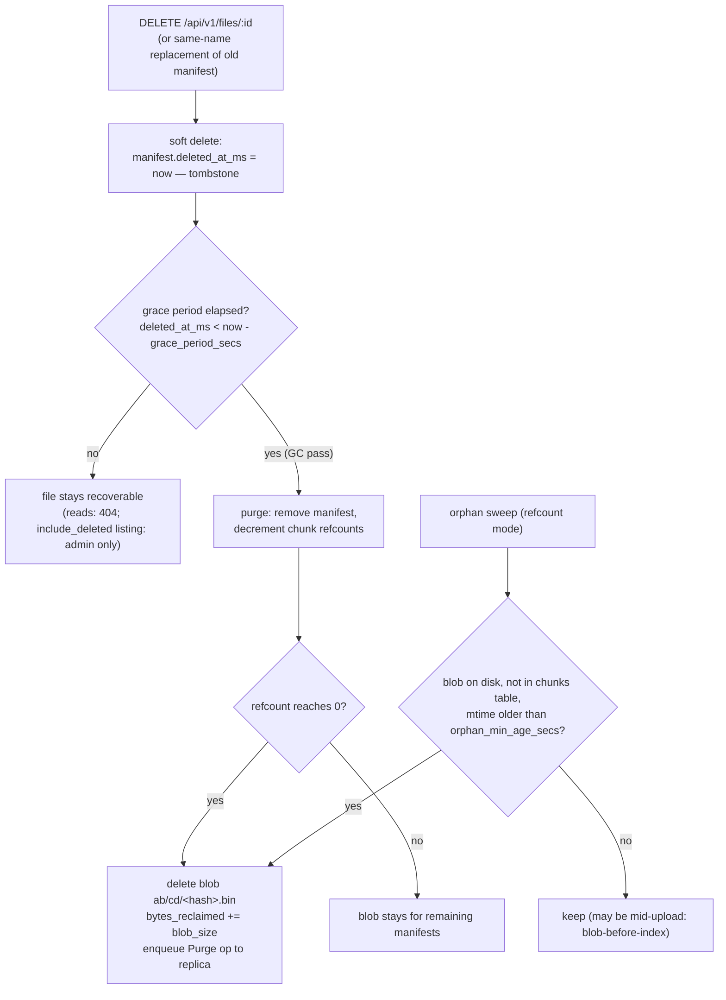

<!--
title: Garbage Collection
category: architecture
audience: operator
last_updated: 2026-11-10
-->

# Garbage Collection

This page explains the file lifecycle from soft delete through the grace period to purge, the two collection modes (refcount on primaries, reachability on replicas), the orphan sweeper, and the admin triggers. Operators scheduling maintenance and planning capacity should read it alongside the [GC operations](../operations/gc-operations.md) runbook.

## Overview

Deletes in file-storage are tombstones: `DELETE /api/v1/files/:id` sets `deleted_at_ms` on the manifest and returns `204` immediately. Nothing is reclaimed at delete time — shared blobs may still be referenced by other files, and the grace period (default `retention.grace_period_secs` = 86400, i.e. 24 hours) is the undo window. A background collector wakes every `gc_interval_secs` (default 300) and reclaims space according to the configured mode. Every pass is bounded to 5 000 work items, and every reclaimed byte is reported in a `GcReport{manifests_purged, chunks_removed, orphans_removed, bytes_reclaimed}`.


*Figure 1: The soft-delete lifecycle and the two reclamation paths (tombstone purge and orphan sweep). GC runs both in refcount mode; replicas run reachability instead.*

## How it works

### Refcount mode (primaries)

`retention.gc_mode: refcount` is the default and the right mode wherever the full `chunks` table is authoritative (primaries, and any replica that applies refcount-affecting ops). Each pass performs two steps:

1. **Purge past-grace tombstones.** Scan manifests for `deleted_at_ms < now − grace_period_secs`, up to the 5 000-item batch limit. For each: remove the manifest, decrement every chunk's refcount, and delete blobs whose refcount reaches 0 (adding their `blob_size` to `bytes_reclaimed`). A purge is also enqueued to the replica so hard deletes propagate.
2. **Orphan sweep against the index.** Load all chunk hashes from redb, list every blob on disk, and delete blobs that are on disk but absent from the index — but only if their modification time is older than `retention.orphan_min_age_secs` (default 3600). The age guard is what makes the blob-before-index write order safe: a blob being written right now is not yet in the index and must not be swept.

Refcounts explain why blobs are never deleted eagerly: a chunk shared by a live file and a tombstoned file keeps its blob until every referencing manifest is purged. Same-name replacement relies on this — the old manifest is soft-deleted while its chunks stay alive.

### Reachability mode (replicas)

`retention.gc_mode: reachability` is designed for replicas, which apply replicated ops and pull-repaired blobs without maintaining authoritative refcounts. A pass builds the reachable set — the union of chunk hashes across all live manifests — after first purging expired tombstones (same grace-period rule). Any blob outside the reachable set and older than `orphan_min_age_secs` is deleted, again bounded by the 5 000-item limit. This mode has no refcount bookkeeping at all; correctness rests on the primary having shipped all `Purge` ops and the grace period having elapsed.

### Disabled mode

`retention.gc_mode: disabled` turns the background loop into a no-op: tombstones accumulate, refcounts are never decremented, and orphans persist. Storage grows monotonically. This mode exists for controlled environments (snapshot-and-restore testing, migrations); a manual trigger can still run an explicit pass.

### Batching, scheduling, and observability

- The **batch limit is 5 000** items per pass (manifest purges and orphan deletions each), so a backlog after a large delete storm drains over several ticks instead of blocking one long pass.
- The **background loop runs every `gc_interval_secs`** (default 300), implemented as a tokio interval with missed ticks delayed — a slow pass never stacks up concurrent passes.
- Metrics: `file_storage_gc_files_purged_total`, `file_storage_gc_bytes_reclaimed_total`, `file_storage_gc_orphans_removed_total`. Each pass also records an audit event with action `storage.gc`, visible to admins via `GET /api/v1/audit`.
- A pass that reclaimed nothing is free — the sweep is two index scans plus a directory walk.

## Configuration

| Key | Default | Meaning |
|---|---|---|
| `retention.gc_mode` | `refcount` | `refcount` \| `reachability` \| `disabled` |
| `retention.grace_period_secs` | `86400` | Tombstone age before purge (24 h undo window) |
| `retention.gc_interval_secs` | `300` | Background loop cadence (minimum 1 s) |
| `retention.orphan_min_age_secs` | `3600` | Minimum blob age before an orphan may be swept |

There is no hot reload; mode changes apply at restart.

## Examples

Manual trigger over REST (admin):

```bash
curl -s -X POST -H "Authorization: Bearer $TOKEN" localhost:8080/api/v1/admin/gc
{
  "manifests_purged": 12,
  "chunks_removed": 340,
  "orphans_removed": 2,
  "bytes_reclaimed": 11042304
}
```

Manual trigger over gRPC — note that the `dry_run` flag of `AdminService/TriggerGC` is currently not supported and responds `UNIMPLEMENTED`; run real passes instead:

```bash
grpcurl -plaintext -H "authorization: Bearer $TOKEN" \
  -d '{"mode": "REFCOUNT"}' \
  localhost:9090 file_storage.v1.AdminService/TriggerGC

# dry_run is rejected rather than silently ignored:
grpcurl -plaintext -d '{"mode": "REFCOUNT", "dry_run": true}' \
  localhost:9090 file_storage.v1.AdminService/TriggerGC
# grpc-status 12 (UNIMPLEMENTED)
```

Omitting `mode` (or sending `MODE_UNSPECIFIED`) uses the node's configured mode; explicitly passing `REFCOUNT` or `REACHABILITY` overrides it for that single pass, which is useful for draining a replica with a one-off refcount sweep.

Watch a pass happen:

```bash
curl -s localhost:8080/metrics | grep gc_
# file_storage_gc_files_purged_total 12
# file_storage_gc_bytes_reclaimed_total 11042304
# file_storage_gc_orphans_removed_total 2
```

## See also

- [GC operations](../operations/gc-operations.md) — scheduling, draining backlogs, and emergency purges
- [Storage Layout](./storage-layout.md) — refcount and `blob_size` encodings being manipulated
- [Replication](./replication.md) — purge propagation and replica reachability GC
- [Data Flow](./data-flow.md) — the blob-before-index ordering the orphan guard protects
- [REST API](../api/rest.md) — `DELETE /files/:id?purge=` and `POST /admin/gc` semantics
- [Monitoring](../operations/monitoring.md) — GC metrics and alerting suggestions
