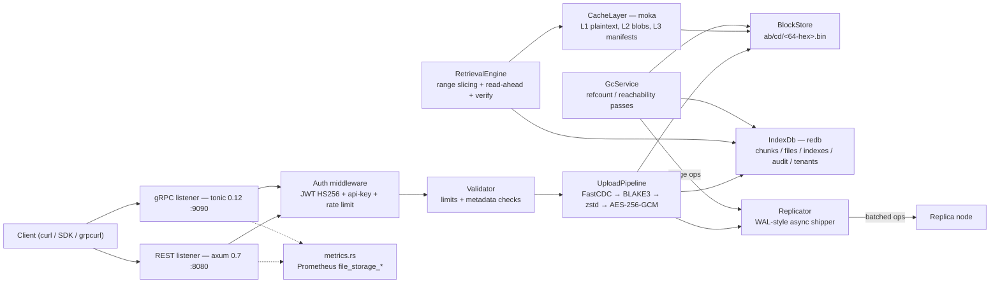

<!--
title: Architecture Overview
category: architecture
audience: all
last_updated: 2026-11-10
-->

# Architecture Overview

This page maps every component of the file-storage service, how they connect, and the design principles that shaped them. It is the entry point to the architecture section: start here, then follow the links into the deep-dive pages for the area you care about (data flow, storage layout, chunking, caching, replication, GC, security).

## Overview

file-storage is a single Rust process that exposes one storage core through two wire protocols: a REST API built on axum 0.7 listening on `server.port` (default `8080`) and a gRPC API built on tonic 0.12 listening on `server.grpc_port` (default `9090`). Both listeners share one `AppState` — index, block store, caches, upload pipeline, retrieval engine, auth, tenants, audit, replicator, and GC — so a file uploaded over gRPC is byte-identical when downloaded over REST, and vice versa.

Files are never stored whole. Every upload is split by FastCDC content-defined chunking, hashed with BLAKE3, compressed with zstd, optionally encrypted with per-tenant AES-256-GCM, and written as content-addressed blobs into a sharded on-disk block store. A redb database holds the metadata (manifests, chunk refcounts, name/tag indexes, audit log, tenants) in a single ACID file.


*Figure 1: Component diagram. Solid arrows are data paths on the write/read paths; the dashed arrows are metrics exposition from both listeners.*

## How it works

### Components

| Component | Responsibility | Key crates | Location |
|---|---|---|---|
| REST API | Router, middleware (auth, api-key, rate limit, request id), handlers, DTOs, error mapping | axum 0.7, tower-http, tower_governor | `src/api/` |
| gRPC API | tonic server: FileService, AuthService, AdminService, ReplicationService, health, reflection, interceptors | tonic 0.12, prost, tonic-reflection, tonic-health | `src/grpc/` |
| Validator | Upload validation: size limits, name/mime/tag metadata | — | `src/core/validator.rs` |
| Chunker | FastCDC v2020 streaming chunker over async byte streams | fastcdc 5.x (tokio feature) | `src/core/chunker.rs` |
| Hasher | Per-chunk BLAKE3, streaming whole-file hash, read-back verification | blake3 1.5 | `src/core/hasher.rs` |
| Compressor | zstd level 3 with `min_size` fallback to raw storage | zstd 0.13 | `src/core/compressor.rs` |
| UploadPipeline | chunk → hash → compress → encrypt → blob write → one atomic index transaction | futures (`buffer_unordered`), tokio | `src/core/pipeline.rs` |
| BlockStore | Content-addressed sharded blob store, atomic temp+rename+fsync writes | tokio (fs) | `src/storage/block_store.rs` |
| IndexDb | ACID metadata index: `chunks`, `files`, `name_index`, `tag_index`, `audit`, `tenants` | redb 2.2, bincode, rmp-serde | `src/storage/index_db.rs` |
| Manifest | Domain structs `Manifest`, `ChunkRef`, `ChunkMeta` | serde, uuid | `src/storage/manifest.rs` |
| RetrievalEngine | L1→L2→disk read path, BLAKE3 verification, read-ahead, range slicing | async-stream | `src/storage/retrieval.rs` |
| CacheLayer | L1 plaintext, L2 stored blobs, L3 manifests (moka) plus HTTP ETag helpers | moka 0.12 | `src/cache/` |
| Encryptor | Per-tenant AES-256-GCM, 0600 key files, storage-key derivation | aes-gcm 0.10, dashmap | `src/security/encryption.rs` |
| Auth / tenants | JWT HS256, argon2id password hashing, rotating refresh tokens, roles | jsonwebtoken, argon2 | `src/security/auth.rs`, `src/security/tenant.rs` |
| AuditLog | Append-only audit events (UUIDv7 keys) persisted in redb | serde_json | `src/security/audit.rs` |
| Replicator | In-memory WAL queue, batched shipping, sync-mode barriers | reqwest, tokio sync | `src/replication/replicator.rs` |
| Replication client | Frame codecs and REST client for `/internal/*` | reqwest, bytes | `src/replication/client.rs` |
| GarbageCollector | Refcount and reachability passes, orphan sweeper | — | `src/gc.rs` |
| Metrics | `file_storage_*` Prometheus counters and histograms | metrics, metrics-exporter-prometheus | `src/metrics.rs` |
| Config | YAML config + `FS_*` environment overrides + validation | config 0.14 | `src/config.rs` |
| Error | `StorageError` variants mapped to HTTP statuses and gRPC codes | thiserror | `src/error.rs` |
| State / boot | `AppState` assembly, graceful shutdown, CLI | clap | `src/state.rs`, `src/lib.rs` |

### Design principles

1. **Content addressing.** Every blob is keyed by its BLAKE3 hash (or a tenant-scoped derivation of it under encryption). Identical content is stored once and reference-counted, which makes dedup a structural property rather than a background job. See [Chunking & Dedup](./chunking.md) and [ADR 0001](./decisions/0001-cas-over-block-store.md).
2. **Crash safety through blob-before-index ordering.** Blobs are fully written and fsynced (temp file → fsync → rename → directory fsync) *before* the single redb transaction that references them. A crash can therefore leave an orphan blob that GC sweeps later — never a dangling index reference to missing data. See [Data Flow](./data-flow.md) and [Storage Layout](./storage-layout.md).
3. **Tenant isolation.** Every manifest carries a `tenant_id`; the `name_index` and `tag_index` tables are tenant-prefixed, so lookups physically cannot cross tenant boundaries. Cross-tenant access requires the `admin` role. See [Security](./security.md).
4. **Immutability of stored blobs.** Blobs are never rewritten in place. Same-name replacement writes a new manifest and soft-deletes the old one; compression and encryption changes produce new content, hence new hashes. Immutability is what makes the caches, replication, and pull-repair safe.
5. **Soft delete + grace period.** Deletes write a tombstone (`deleted_at_ms`); a background collector purges only after `retention.grace_period_secs` (default 86400), keeping accidental-delete recovery possible. See [Garbage Collection](./gc.md).

## Configuration

All runtime knobs live in a YAML file (see `config/default.yaml`) and can be overridden with environment variables using the `FS_` prefix plus `__` nesting (for example `FS_SERVER__GRPC_PORT=9091`). There is no hot reload: every key requires a restart.

| Section | What it controls |
|---|---|
| `server` | Bind host, REST `port` (8080), `grpc_port` (9090), `grpc_tls` |
| `storage` | `root` (block store), `temp_dir` (multipart spool), `shard_depth` (0–4) |
| `database` | `path` to the redb file |
| `chunking` | FastCDC `min` / `avg` / `max` (8192 / 32768 / 131072) |
| `compression` | zstd `level` (3) and `min_size` (1024) |
| `cache` | L1/L2 byte budgets and TTLs, manifest capacity/TTL |
| `auth` | `jwt_secret`, access/refresh TTLs, static `users` |
| `encryption` | `enabled`, `keys_dir` |
| `rate_limit` | `per_second`, `burst` |
| `replication` | `enabled`, `mode` (async/sync), `target_url`, `upstream_url`, queue/batch/flush tuning |
| `retention` | `gc_mode`, `grace_period_secs`, `gc_interval_secs`, `orphan_min_age_secs` |
| `limits` | `max_file_size` (10 GiB), `max_body` (1 GiB) |
| `tenants` | Seeded tenant IDs and names |

The full key-by-key reference lives in the [Configuration reference](../configuration/reference.md); environment-variable syntax is covered under [Environment Variables](../configuration/environment.md).

## Examples

Log in, upload, and read back over both transports:

```bash
TOKEN=$(curl -s -X POST localhost:8080/api/v1/auth/login \
  -H 'Content-Type: application/json' \
  -d '{"username":"admin","password":"admin123"}' | jq -r .access_token)

# upload (raw body, streamed)
curl -s -X POST "localhost:8080/api/v1/files?name=f.bin&tags=demo" \
  -H "Authorization: Bearer $TOKEN" \
  -H 'Content-Type: application/octet-stream' \
  --data-binary @/tmp/f.bin

# download over gRPC after uploading over REST — same bytes
grpcurl -plaintext -d '{"service": "file_storage.v1.FileService"}' \
    localhost:9090 grpc.health.v1.Health/Check
```

A successful upload returns the dedup report inline:

```json
{
  "file_id": "01930000-0000-7000-8000-0000000000ab",
  "size": 67108864,
  "size_stored": 67102208,
  "chunk_count": 2048,
  "dedup_chunks": 12,
  "dedup_bytes": 393216,
  "content_hash": "9f2c…64-hex…"
}
```

## See also

- [Data Flow](./data-flow.md) — upload and retrieval paths step by step
- [Storage Layout](./storage-layout.md) — sharded blobs and the six redb tables
- [Chunking & Dedup](./chunking.md) — FastCDC mechanics and dedup math
- [Caching](./caching.md) — the three moka tiers and read-ahead
- [Replication](./replication.md) — WAL shipping and replica repair
- [Garbage Collection](./gc.md) — soft delete, refcount, reachability
- [Security](./security.md) — auth, encryption, tenant isolation
- [REST API](../api/rest.md) and [gRPC API](../api/grpc.md) — wire-level reference for both listeners
- [Configuration reference](../configuration/reference.md) — every key and default
- [Monitoring](../operations/monitoring.md) — the `file_storage_*` metrics in practice
