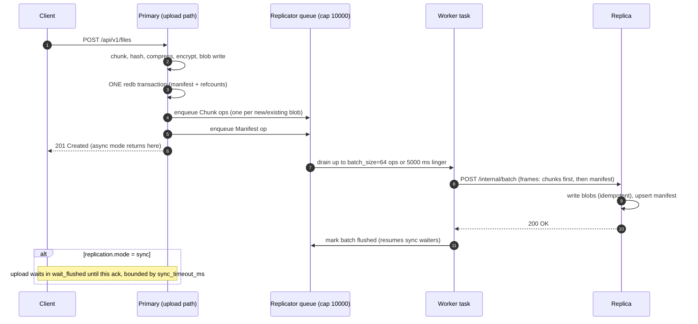

<!--
title: Replication
category: architecture
audience: architect
last_updated: 2026-11-10
-->

# Replication

This page describes the WAL-style replication shipper, its queue and backpressure behaviour, the sync/async consistency models, the two internal transports, and how replicas repair themselves on read misses. Architects designing multi-node deployments and operators running replicas should read it; day-2 procedures live in the [Replication Ops](../operations/replication-ops.md) guide.

## Overview

A primary streams operations to exactly one replica target through an in-memory, bounded queue drained by a background worker. Ops are idempotent and strictly ordered per file (chunk blobs first, then the manifest), which lets the replica apply them safely even after replays. Replicas can additionally pull missing blobs on demand from the primary when a read hits a gap, and run a reachability-mode GC instead of refcount GC. Replication is disabled by default; enabling it requires `replication.enabled: true` plus a `target_url` and shared `api_key`.

## How it works

### The queue and worker

The `Replicator` (in `src/replication/replicator.rs`) owns an mpsc channel of capacity `replication.queue_capacity` (default 10 000). Upload paths `send` ops into it; when the queue is full, `send` awaits a slot — backpressure propagates to uploads rather than dropping ops. A single worker task drains the channel:

| Parameter | Default | Behaviour |
|---|---|---|
| `queue_capacity` | 10000 | Bounded in-memory queue; senders backpressure when full |
| `batch_size` | 64 | Ops shipped per batch (minimum internal drain of 8) |
| `flush_interval_ms` | 5000 | Maximum linger before a partial batch is flushed |
| Backoff | 100 ms → 500 ms → 2 s | Exponential on upstream failure, then held at 2 s until recovery |

The queue holds four op kinds: `Chunk` (a full blob payload with hashes, sizes, flags), `Manifest` (a file upsert), `Purge` (hard-delete propagation), and `Flush` — a sentinel carrying a oneshot reply that implements the sync-mode barrier.

### Op ordering and idempotency

The upload pipeline enqueues each chunk payload *before* the manifest op, and the channel preserves order, so a replica never sees a manifest referencing blobs it has not received. Ops are idempotent by construction: `put_chunk` writes a content-addressed blob (a repeated write is a no-op), `put_manifest` upserts by `file_id`, and `delete_file` with `purge=true` removes the manifest. Replays after a crash or timeout are therefore safe, and the replica can acknowledge batches without deduplication logic.

### Consistency model

- **Async mode (default):** uploads succeed as soon as the local index transaction commits; ops ship within one batch window. The model is **eventual consistency**: a crash on the primary loses the un-flushed tail of the queue — a bounded window of at most `queue_capacity` ops, typically the last ≤5 seconds of writes. In-memory queueing is a deliberate trade (see [ADR 0006](./decisions/0006-wal-shipping-replication.md)); the replica's pull-repair and reachability GC reconcile the residue.
- **Sync mode (`replication.mode: sync`):** the upload blocks in `wait_flushed` until the worker has shipped a batch containing the file's ops and the replica acknowledged it, bounded by `sync_timeout_ms` (default 5000). A timeout surfaces as `Unavailable` (HTTP 503 `service_unavailable`, gRPC `UNAVAILABLE`), giving **acked durability** at the cost of upload latency.

Metrics make queue health visible: `file_storage_replication_queue_depth` (gauge), `file_storage_replication_failures_total`, `file_storage_replication_ops_applied_total`, and `file_storage_replication_flush_seconds{status}`.

### Purge propagation and replica GC

When GC on the primary purges a past-grace tombstone, it enqueues a `Purge` op, so hard deletes propagate to the replica instead of lingering as orphans. Replicas are expected to run `retention.gc_mode: reachability`: live manifests define the reachable blob set, expired tombstones are dropped, and any blob outside the reachable set (and older than `orphan_min_age_secs`) is deleted — no refcounts required.

### Replica pull-repair

A replica configured with `replication.upstream_url` heals read gaps on demand: when a disk read misses a blob, the retrieval engine fetches it from the upstream primary (REST `GET /internal/chunk/:hash` or gRPC `PullChunk`), writes it locally, and serves the read. Admin resync (`POST /api/v1/admin/resync/:id`, gRPC `Resync`) pushes a full file bundle proactively.

### The two transports

| | REST `/internal/*` | gRPC `ReplicationService` |
|---|---|---|
| Auth | `X-Api-Key` header | `x-api-key` metadata |
| Batch send | `POST /internal/batch` with the binary frame codec | `ReplicateBatch` — bidi stream of `ReplicationOp{put_chunk \| put_manifest \| delete_file \| flush}` → `ReplicationAck{ops_acked, success, error}` |
| Blob fetch | `GET /internal/chunk/:hash` | `PullChunk` — header then data pieces of ≤64 KiB |
| Manifest fetch | `GET /internal/file/:id` | `PullManifest` → `ManifestBundle{manifest}` |
| Used by | The built-in WAL shipper and its client codecs | External integrations and custom shippers |

The frame codec (in `src/replication/client.rs`) is compact and self-describing per batch: a `u32` item count followed by `hash(32) | plain_hash(32) | u64 size_original | u64 size_stored | u8 flags (bit0 compressed, bit1 encrypted) | u32 blob_len | blob` for each chunk. Manifests and file bundles use MessagePack framed by a `u32` length prefix.


*Figure 1: A replicated upload in async mode. On failure the worker retries the same batch after the 100 ms → 500 ms → 2 s backoff ladder.*

## Configuration

| Key | Default | Notes |
|---|---|---|
| `replication.enabled` | `false` | Master switch; also gates `/internal/*` acceptance on replicas |
| `replication.mode` | `async` | `sync` blocks uploads until flush ack |
| `replication.target_url` | `null` | Primary → replica shipping endpoint (e.g. `http://replica:8080`) |
| `replication.upstream_url` | `null` | Replica → primary pull-repair endpoint |
| `replication.api_key` | — | Shared secret for both `X-Api-Key` and `x-api-key` |
| `replication.queue_capacity` | `10000` | In-memory; raise cautiously (memory) |
| `replication.batch_size` | `64` | Ops per batch |
| `replication.flush_interval_ms` | `5000` | Max linger of a partial batch |
| `replication.sync_timeout_ms` | `5000` | Sync-mode barrier budget |

Environment overrides: `FS_REPLICATION__ENABLED=true`, `FS_REPLICATION__TARGET_URL=http://replica:8080`, and so on. Internal traffic is plain HTTP by design; terminate TLS at your ingress, or front the gRPC listener with `server.grpc_tls` (mTLS via `client_ca_path` is recommended for node-to-node links).

## Examples

Minimal primary + replica compose topology (the repository's `docker-compose.yml` ships this as profiles — primary `:8080/:9090`, replica `:8081/:9091`, Prometheus `:9099`):

```yaml
# primary
replication:
  enabled: true
  mode: async
  target_url: "http://replica:8080"
  api_key: "change-me-internal"

# replica
retention:
  gc_mode: reachability
replication:
  upstream_url: "http://primary:8080"
  api_key: "change-me-internal"
```

Check shipping health from the metrics endpoint:

```bash
curl -s localhost:8080/metrics | grep replication
# file_storage_replication_queue_depth 0
# file_storage_replication_ops_applied_total 14213
# file_storage_replication_flush_seconds_count{status="ok"} 218
```

A manual resync of one file (admin):

```bash
curl -s -X POST -H "Authorization: Bearer $TOKEN" \
     localhost:8080/api/v1/admin/resync/<file_id>
# {"file_id":"…","replicated":true}
```

## See also

- [ADR 0006 — WAL shipping replication](./decisions/0006-wal-shipping-replication.md) — the design decision and alternatives
- [Garbage Collection](./gc.md) — reachability mode and purge propagation
- [Data Flow](./data-flow.md) — where replication hooks into the upload pipeline
- [gRPC API](../api/grpc.md) — the `ReplicationService` contract in full
- [Replication Ops](../operations/replication-ops.md) — failover, repair, and monitoring procedures
- [Configuration reference](../configuration/reference.md) — every `replication.*` key
