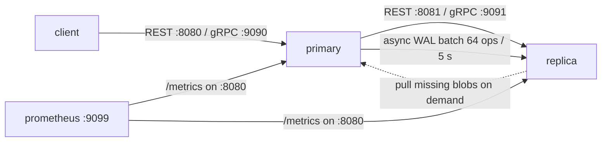

<!-- title: Docker Compose category: deployment audience: developer|operator last_updated: 2026-11-10 -->

# Docker Compose

The repository ships a `docker-compose.yml` that stands up a two-node stack: a **primary** with replication enabled, a **replica** that pulls from it, and a **Prometheus** instance scraping both. This page walks through the file exactly as it ships, verifies end-to-end replication, and lists the pitfalls to avoid. (The single-container equivalent is covered on the Docker page in the Getting Started section.)

## Overview

The compose stack demonstrates the recommended deployment shape — one writable primary plus one read replica — with everything wired through `FS_` environment overrides on top of the baked-in configuration. Both services keep their data in named volumes, so `docker compose down` preserves the block store and index across restarts.



*Figure 1: the compose topology — primary ships operations to the replica; Prometheus scrapes both REST ports.*

## How it works

### Services

| Service | Image | Purpose |
|---|---|---|
| `primary` | `file-storage:1.0.0` (built from `.`) | Writable node, replication producer |
| `replica` | `file-storage:1.0.0` | Read-only companion, replication consumer |
| `prometheus` | `prom/prometheus:v2.53.0` | Scrapes both nodes' `/metrics` |
| `grpcurl` | `fullstorydev/grpcurl:v1.9.1` | One-shot gRPC discovery check (profile `grpc-test`) |

### Ports

| Service | Container port | Host port | Note |
|---|---|---|---|
| primary REST | 8080 | 8080 | Public entry point |
| primary gRPC | 9090 | 9090 | Reflection + health enabled |
| replica REST | 8080 | **8081** | Host 8080 is taken by the primary |
| replica gRPC | 9090 | **9091** | Host 9090 is taken by the primary |
| prometheus | 9090 | **9099** | Host 9090 belongs to the primary's gRPC listener |

Prometheus scrapes both application containers **on their container port 8080** (`/metrics` is served by the REST listener); the remapped host port only affects your browser.

### Environment

Primary (replication producer):

| Variable | Value | Meaning |
|---|---|---|
| `FS_REPLICATION__ENABLED` | `true` | Start the WAL shipper |
| `FS_REPLICATION__MODE` | `async` | Batch 64 ops / flush every 5 s; uploads never block |
| `FS_REPLICATION__TARGET_URL` | `http://replica:8080` | Ship operations to the replica's REST port |
| `FS_REPLICATION__API_KEY` | `cluster-api-key-change-me` | Shared secret for `/internal/*` and the gRPC `ReplicationService` |
| `FS_STORAGE__ROOT` / `FS_DATABASE__PATH` / `FS_ENCRYPTION__KEYS_DIR` | `/var/lib/file-storage/data/...` | Keep all state on the named volume |

Replica (replication consumer):

| Variable | Value | Meaning |
|---|---|---|
| `FS_REPLICATION__ENABLED` | `false` | The replica does not ship further |
| `FS_REPLICATION__UPSTREAM_URL` | `http://primary:8080` | Where to pull missing blobs for on-demand repair |
| `FS_RETENTION__GC_MODE` | `reachability` | Replica GC keeps only blobs referenced by live manifests |
| `FS_REPLICATION__API_KEY` | same as primary | Must match on both sides |

Both nodes write `FS_LOGGING__FORMAT=json` with `RUST_LOG=info`.

## Configuration

Two things must be changed before this stack touches real data:

1. **`FS_REPLICATION__API_KEY` must be replaced** on both services. The shipped value `cluster-api-key-change-me` is a placeholder; generate one with `openssl rand -hex 24` and set it identically on primary and replica (or manage it via secrets — see [Secrets](../configuration/secrets.md)).
2. **The demo users** in the baked-in `default.yaml` (including `admin/admin123`) remain active unless you mount your own configuration or override `FS_AUTH__USERS`. For anything beyond a demo, bake a production configuration into the image or mount one over `/etc/file-storage/default.yaml`.

Volumes `fs_primary` and `fs_replica` hold blocks, temp files, the redb index and per-tenant keys, keeping primary and replica data strictly separated.

## Examples

### Start, verify, stop

```bash
# start the stack (builds the image first)
docker compose up --build -d

# one-shot gRPC discovery against the primary (profile grpc-test)
docker compose run --rm grpcurl
# runs: grpcurl -plaintext -max-time 5 primary:9090 list
```

Verify replication end to end:

```bash
# 1. log in on the primary
TOKEN=$(curl -s -X POST localhost:8080/api/v1/auth/login \
  -H 'Content-Type: application/json' \
  -d '{"username":"admin","password":"admin123"}' | jq -r .access_token)

# 2. upload a file on the primary
RESP=$(curl -s -X POST "localhost:8080/api/v1/files?name=compose-demo.txt" \
  -H "Authorization: Bearer $TOKEN" --data-binary @/etc/hostname)

# 3. wait for the async flush interval (flush_interval_ms = 5000)
sleep 6

# 4. the file is visible on the replica (host port 8081)
curl -s -H "Authorization: Bearer $TOKEN" 'localhost:8081/api/v1/files?limit=5' | jq
```

Stop and downgrade:

```bash
docker compose stop        # containers stop, volumes kept
docker compose start       # resume
docker compose down        # remove containers; named volumes are kept
docker compose down -v     # WARNING: also deletes fs_primary and fs_replica
```

The replica stays independently readable while the primary is down (serve reads from host port 8081); it simply receives no new operations until the primary returns.

## Common pitfalls

| Pitfall | Symptom | Fix |
|---|---|---|
| API key mismatch | replica returns 401 on `/internal/*`; `replication_failures_total` climbs | Set the same `FS_REPLICATION__API_KEY` on both services |
| Shipper sends to the wrong port | `replication_error` / UNAVAILABLE, nothing replicates | `target_url` must point at the replica's **REST** port (`http://replica:8080`), not 9090 |
| Expecting instant replication | new file missing on the replica | Async mode flushes every `flush_interval_ms` (5 s); wait at least one interval, or use `mode: sync` |
| Port clash in the browser | Prometheus unreachable on `:9090` | It is published on host port **9099** |
| Deleting volumes by accident | data gone after `down -v` | Back up before destructive commands (see [Backup & Restore](../operations/backup-restore.md)) |
| Replica GC confusion | blobs vanish on the replica | Reachability mode is correct for replicas; refcount mode is for primaries |

## See also

- [Configuration reference](../configuration/reference.md) — every `FS_` override used above.
- [Scaling](./scaling.md) — extending this topology to many shards.
- [Replication Ops](../operations/replication-ops.md) — resync, repair and monitoring of the shipper.
- [TLS](./tls.md) — adding mTLS to the replication channel.
- [Secrets](../configuration/secrets.md) — managing the replication API key.
- [Runbook](../operations/runbook.md) — operating procedures for the running stack.
