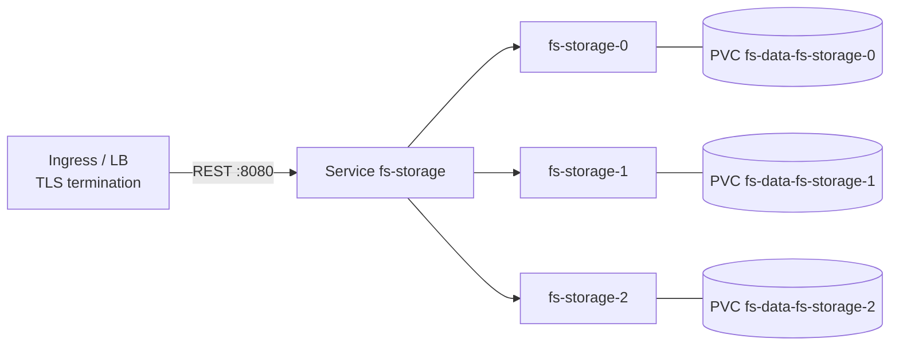

<!-- title: Kubernetes category: deployment audience: operator|architect last_updated: 2026-11-10 -->

# Kubernetes

This page provides a complete, working set of manifests for running file-storage on Kubernetes: a Secret for credentials, a headless Service, a StatefulSet with a per-pod PVC, and a cluster Service. The default topology is a **single writable node**; scaling out to three replicas (independent nodes, each with its own data) is shown with its caveats. (The two-node Docker Compose stack is described on the Docker Compose page.)

## Overview

file-storage is a stateful, single-process service: all state (block store, redb index, per-tenant keys) lives under one data directory, and the redb index permits exactly one writer per database file. The natural Kubernetes mapping is therefore a **StatefulSet** with one pod per storage volume — stable identity, stable storage, no shared-writer risk. External TLS terminates at the ingress; inside the cluster the service speaks plain HTTP.

## How it works



*Figure 1: each StatefulSet pod owns its own PVC and its own independent data set.*

Important consequence: multiple replicas of the StatefulSet are **independent storage nodes**, not a shared-disk cluster. There is no shared-block-store mode — each node owns its data directory, and cross-node duplication is achieved with replication, not with NFS or a shared filesystem (see [Scaling](./scaling.md) for shard topologies and [Replication Ops](../operations/replication-ops.md) for operations).

## Configuration

The manifest below expresses the whole deployment in one block:

- **Secret** `fs-secrets` carries the JWT secret, replication API key and the admin password (all injected as `FS_*` overrides).
- **Headless Service** `fs-storage-headless` gives pods stable DNS names; the normal Service `fs-storage` load-balances REST traffic.
- **StatefulSet** `fs-storage` uses `volumeClaimTemplates` so every pod gets its own PVC mounted at `/var/lib/file-storage/data`; the readiness probe hits `/ready`, the liveness probe `/health`.
- Ports 8080 (REST) and 9090 (gRPC) are declared on the container.

```yaml
apiVersion: v1
kind: Secret
metadata:
  name: fs-secrets
type: Opaque
stringData:
  jwt-secret: "REPLACE_WITH_OPENSSL_RAND_HEX_32"
  replication-api-key: "REPLACE_WITH_OPENSSL_RAND_HEX_24"
  admin-password: "REPLACE_ME"
---
apiVersion: v1
kind: Service
metadata:
  name: fs-storage-headless
  labels: { app: fs-storage }
spec:
  clusterIP: None
  selector: { app: fs-storage }
  ports:
    - { name: rest, port: 8080, targetPort: 8080 }
    - { name: grpc, port: 9090, targetPort: 9090 }
---
apiVersion: v1
kind: Service
metadata:
  name: fs-storage
  labels: { app: fs-storage }
spec:
  selector: { app: fs-storage }
  ports:
    - { name: rest, port: 8080, targetPort: 8080 }
    - { name: grpc, port: 9090, targetPort: 9090 }
---
apiVersion: apps/v1
kind: StatefulSet
metadata:
  name: fs-storage
spec:
  serviceName: fs-storage-headless
  replicas: 1            # single-node default; 3 is possible (see notes)
  selector:
    matchLabels: { app: fs-storage }
  template:
    metadata:
      labels: { app: fs-storage }
      annotations:
        prometheus.io/scrape: "true"
        prometheus.io/port: "8080"
    spec:
      containers:
        - name: file-storage
          image: file-storage:1.0.0
          ports:
            - { containerPort: 8080, name: rest }
            - { containerPort: 9090, name: grpc }
          env:
            - name: FS_SERVER__PORT
              value: "8080"
            - name: FS_SERVER__GRPC_PORT
              value: "9090"
            - name: FS_STORAGE__ROOT
              value: /var/lib/file-storage/data/blocks
            - name: FS_STORAGE__TEMP_DIR
              value: /var/lib/file-storage/data/tmp
            - name: FS_DATABASE__PATH
              value: /var/lib/file-storage/data/index.redb
            - name: FS_ENCRYPTION__KEYS_DIR
              value: /var/lib/file-storage/data/keys
            - name: FS_AUTH__JWT_SECRET
              valueFrom: { secretKeyRef: { name: fs-secrets, key: jwt-secret } }
            - name: FS_LOGGING__FORMAT
              value: json
          readinessProbe:
            httpGet: { path: /ready, port: 8080 }
            initialDelaySeconds: 3
            periodSeconds: 10
          livenessProbe:
            httpGet: { path: /health, port: 8080 }
            initialDelaySeconds: 5
            periodSeconds: 15
          resources:
            requests: { cpu: "250m", memory: 256Mi }
            limits:   { cpu: "2",    memory: 2Gi }
          volumeMounts:
            - name: fs-data
              mountPath: /var/lib/file-storage/data
  volumeClaimTemplates:
    - metadata:
        name: fs-data
      spec:
        accessModes: ["ReadWriteOnce"]
        resources:
          requests:
            storage: 50Gi
```

### Notes on the manifest

- `readinessProbe` targets `/ready`, which returns 503 until the database and storage root check out — pods do not receive traffic before they can serve.
- The image runs as the distroless `nonroot` user (uid 65532); most CSI-provisioned volumes are writable by any uid by default. If your storage class enforces root ownership, set the pod security context (`fsGroup: 65532`).
- User accounts: the baked-in configuration applies unless you supply your own. Set user credentials via your own config file mounted over `/etc/file-storage/default.yaml` (recommended in production).

### Ingress

- **REST**: terminate TLS at the ingress (nginx, ALB, Traefik…) and forward plain HTTP to the `fs-storage` Service on 8080. There is no TLS stack in the REST listener by design — internal traffic is plain HTTP inside the cluster.
- **gRPC**: use a gRPC-capable ingress (or the same ingress with HTTP/2 pass-through / `grpc` backend protocol) targeting port 9090, or expose 9090 via NodePort/LoadBalancer. For TLS on the gRPC listener itself, see [TLS](./tls.md).

## Examples

### Deploy and verify

```bash
kubectl apply -f file-storage.yaml
kubectl get pods -l app=fs-storage
kubectl rollout status statefulset/fs-storage

# smoke test through a port-forward
kubectl port-forward svc/fs-storage 8080:8080
curl -s localhost:8080/ready && echo
curl -s -X POST localhost:8080/api/v1/auth/login \
  -H 'Content-Type: application/json' \
  -d '{"username":"admin","password":"admin123"}' | jq -r .access_token
```

### Upgrade strategy

With `volumeClaimTemplates`, each pod owns a dedicated RWO PVC, so the default `RollingUpdate` works pod-by-pod. Two caveats matter:

1. **Shared PVC**: if you instead attach one RWO PVC via `claimName` to multiple pods, a rolling update stalls — the new pod cannot mount the volume while the old one holds it. Use `strategy.type: Recreate`, or provision `ReadWriteMany` storage.
2. **replicas > 1**: every pod is an independent node with its own (initially empty) data set. Point replication at the pod DNS names (`fs-storage-0.fs-storage-headless...`) and treat the pods as shards, not as interchangeable workers — see [Scaling](./scaling.md).

## See also

- [Scaling](./scaling.md) — sharding, load balancing and capacity planning.
- [TLS](./tls.md) — gRPC server TLS and mTLS for replication.
- [Configuration reference](../configuration/reference.md) — every `FS_` override.
- [Secrets](../configuration/secrets.md) — handling JWT secrets and API keys outside git.
- [Backup & Restore](../operations/backup-restore.md) — protecting the PVC contents.
- [Runbook](../operations/runbook.md) — operating procedures once deployed.
