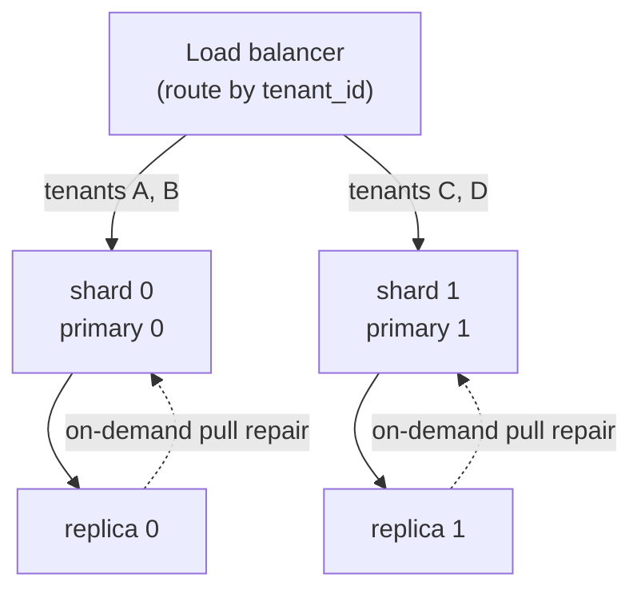

<!-- title: Scaling category: deployment audience: architect|operator last_updated: 2026-11-10 -->

# Scaling

This page describes how file-storage scales horizontally: sharding into primary/replica pairs, routing tenants to shards, adding read capacity, and the load-balancer setup for both transports. It also gives the capacity math you need for sizing, and the built-in limits you should watch at scale.

## Overview

A single file-storage node already saturates typical disks for many workloads (measured: 119 MB/s upload over HTTP on a small 2-vCPU sandbox, ~1.1 GB/s warm downloads). Scale out by sharding: each shard is a stateful **primary + replica pair** that owns a slice of tenants. There is no shared-storage mode — horizontal growth comes from adding shards, not from making more processes share one disk.

## How it works

### Shard topology



*Figure 1: each shard is a primary/replica pair; the balancer pins every tenant to one primary.*

The routing contract is simple: **all writes for a tenant go to that tenant's primary**. Consistent hashing or a small mapping table at the load balancer both work — the tenant UUID is present in every manifest and in the JWT (`tenant` claim), so an L7 proxy can route on it once authenticated.

### Why a shared block store is NOT supported

Each node exclusively owns its data directory: the block store (`storage.root`) and the redb index (`database.path`) are local, and redb is a **single-writer** database file — one process must own it at a time. Attaching two nodes to the same volume over NFS or a shared block device is unsupported and unsafe (corruptible index, racing blob writes). The supported mechanism for multiple nodes holding the same content is **replication**: the primary ships operations to replicas, and replicas pull any missing blobs on demand. When you need more capacity, add shards; when you need redundancy, add replicas.

### Read scaling

Replicas are full readers: they serve downloads, metadata and listings from their own cache and disk, exactly like a primary. A replica that receives a read for a blob it has not yet received ships a pull request to `replication.upstream_url` (on-demand pull repair) and serves the bytes after repair. Practical consequence: adding replicas adds linear read capacity and geographic proximity without touching the primary's write path.

## Configuration

### Load balancing

| Transport | Layer | Guidance |
|---|---|---|
| REST | L7 | Route by path/tenant; the API is plain HTTP with JWT bearer auth — terminate TLS at the balancer |
| gRPC | **L4** | Forward raw TCP to port 9090 (or HTTP/2 pass-through). Long-lived bidirectional streams (Upload/Download/ReplicateBatch) break if a proxy rebalances mid-stream |

Keep sessions sticky *per tenant* for writes, never per chunk: one upload is a stream of independent chunk operations, but the manifest commit expects a single primary.

### Capacity math

Sizing starts from three numbers:

1. **Dedup ratio** — the fraction of stored bytes eliminated by re-use. Duplicate-heavy workloads routinely reach 2× or better; check `file_storage_dedup_bytes_saved_total` after a pilot.
2. **Chunk overhead** — each chunk carries metadata in the redb index (`ChunkMeta`: refcount, blob size, timestamp) plus a row in the manifest. Per-chunk overhead is **a few hundred bytes**, ~1% at the 32 KiB average chunk size; negligible unless you store billions of tiny files.
3. **Encryption padding** — with encryption enabled each blob adds 28 bytes (12-byte nonce + 16-byte GCM tag).

A rough sizing formula per shard: `disk ≈ logical_bytes × (1 − dedup_ratio) × 1.01 + 28 B × chunk_count`, plus headroom for GC grace-period retention and cache write bursts. Provision RAM for the caches (256 MiB L1 + 512 MiB L2 by default) on top of the working-set manifests.

## Examples

### Adding a shard

```bash
# shard 2 primary
FS_SERVER__PORT=8082 \
FS_REPLICATION__ENABLED=true \
FS_REPLICATION__TARGET_URL=http://replica2:8082 \
FS_REPLICATION__API_KEY=<cluster-key> \
file-storage --config /etc/file-storage/default.yaml

# shard 2 replica
FS_SERVER__PORT=8083 \
FS_REPLICATION__ENABLED=false \
FS_REPLICATION__UPSTREAM_URL=http://primary2:8082 \
FS_RETENTION__GC_MODE=reachability \
FS_REPLICATION__API_KEY=<cluster-key> \
file-storage --config /etc/file-storage/default.yaml
```

Then register `tenant → shard 2` in your balancer. No data migration is needed for new tenants; existing tenants move only if you choose to migrate them (export and re-upload, or let the balancer keep them on their original shard).

### Verifying routing

```bash
# a tenant-scoped login; the tenant claim decides which shard must serve it
curl -s localhost:8080/api/v1/files -H "Authorization: Bearer $ALICE_TOKEN" | jq .total
```

If a tenant's requests reach the wrong shard, uploads succeed but are invisible to the intended shard's replicas — always verify routing with a canary upload before cutting traffic over.

### Limits to watch at scale

| Limit | Where | Guidance |
|---|---|---|
| redb single writer | `database.path` | One process per index file — this is what makes shards, not replicas, the write-scaling unit |
| Per-tenant token bucket | `rate_limit.per_second` / `burst` (gRPC) | A hot tenant can exhaust its own bucket without affecting others; tune per workload |
| REST IP rate limiting | tower_governor keyed by client IP | Behind a balancer, key on the real client IP or raise the burst |
| Replication queue | `queue_capacity` 10000 ops | Sustained overload backpressures uploads; increase capacity or add shards |
| gRPC message ceiling | 256 MiB per message | Streamed uploads are chunk-wise, so this rarely binds |

## See also

- [TLS](./tls.md) — securing the replication channel between shards.
- [Replication Ops](../operations/replication-ops.md) — health, resync and repair of replicas.
- [Configuration reference](../configuration/reference.md) — the knobs referenced above.
- [Runbook](../operations/runbook.md) — shard failover procedures.
