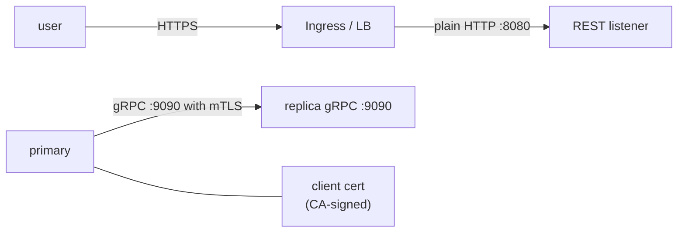

<!-- title: TLS category: deployment audience: operator|architect|security-engineer last_updated: 2026-11-10 -->

# TLS

This page covers the three TLS surfaces of file-storage: terminating TLS for REST at your ingress (the REST listener itself is plain HTTP), native TLS and mTLS on the gRPC listener via `server.grpc_tls`, and the certificate generation recipes to run both. The implementation uses rustls with the ring crypto provider — there is no OpenSSL dependency.

## Overview

file-storage follows the standard cluster pattern: **plain HTTP inside the perimeter, TLS at the edge**. The REST listener (axum) has no TLS stack by design and expects the ingress or load balancer to terminate TLS. The gRPC listener (tonic) supports server-side TLS and optional mutual TLS natively, which is the recommended way to protect the replication channel between primaries and replicas.



*Figure 1: TLS terminates at the ingress for REST; the gRPC listener does its own TLS/mTLS.*

## How it works

### REST: TLS termination at the ingress

Point your ingress at the REST port and let it own the certificate:

- **Kubernetes**: an Ingress resource terminates TLS and forwards plain HTTP to the Service on port 8080.
- **Cloud load balancers**: an ALB/NLB with an ACM certificate in front of 8080.
- **Self-hosted**: nginx/Envoy/Caddy in front of the service.

Documented upstream-TLS options if you must encrypt further than the edge: place a TLS sidecar or local proxy (nginx, Envoy) next to the process and terminate there — the application itself speaks HTTP only. Because REST traffic carries `Authorization: Bearer` headers, never expose 8080 directly to untrusted networks.

### gRPC: server TLS and mTLS

TLS for the gRPC listener is configured in one place:

```yaml
server:
  grpc_tls:
    enabled: true
    cert_path: "/etc/file-storage/tls/server.crt"
    key_path: "/etc/file-storage/tls/server.key"
    client_ca_path: null     # set to enable mTLS: client certificates REQUIRED
```

- `enabled: true` requires `cert_path` and `key_path` (validated at boot).
- Setting `client_ca_path` to a PEM CA bundle **switches the listener to mutual TLS**: every client must present a certificate chaining to that CA. The production template enables both, using mTLS to lock the replication channel between peers.

TLS is implemented with rustls; the process pins the **ring** provider explicitly (installed once at startup), avoiding rustls provider ambiguity between tonic's TLS feature and other crypto users of the crate.

## Configuration

### Generate a CA, server certificate and client certificates

```bash
mkdir -p tls && cd tls

# 1. CA
openssl genrsa -out ca.key 4096
openssl req -x509 -new -nodes -key ca.key -sha256 -days 3650 \
  -subj "/CN=file-storage-demo-ca" -out ca.crt

# 2. server certificate with SANs for every address clients will dial
openssl genrsa -out server.key 2048
openssl req -new -key server.key -subj "/CN=file-storage" -out server.csr
cat > server.ext <<'EOF'
subjectAltName = DNS:localhost, DNS:file-storage, DNS:replica, IP:127.0.0.1
extendedKeyUsage = serverAuth
EOF
openssl x509 -req -in server.csr -CA ca.crt -CAkey ca.key -CAcreateserial \
  -days 825 -sha256 -extfile server.ext -out server.crt

# 3. client certificate (for mTLS peers and SDKs)
openssl genrsa -out client.key 2048
openssl req -new -key client.key -subj "/CN=file-storage-client" -out client.csr
cat > client.ext <<'EOF'
extendedKeyUsage = clientAuth
EOF
openssl x509 -req -in client.csr -CA ca.crt -CAkey ca.key -CAcreateserial \
  -days 825 -sha256 -extfile client.ext -out client.crt
```

Deploy `server.crt`/`server.key` (and `ca.crt` when enabling mTLS) to `server.grpc_tls.*_path` on the server; distribute `client.crt`/`client.key` to every replication peer and trusted client. Protect private keys with file mode 0600 (see [Secrets](../configuration/secrets.md)).

### grpcurl over TLS

```bash
# TLS, skipping certificate verification (quick tests only)
grpcurl -insecure localhost:9090 list

# TLS with a pinned CA
grpcurl --tls-ca tls/ca.crt localhost:9090 list

# mTLS: present a client certificate as well
grpcurl --tls-ca tls/ca.crt --cert tls/client.crt --key tls/client.key \
  localhost:9090 file_storage.v1.AuthService/Login
```

### Rust SDK over TLS

```rust
use file_storage::grpc::FileStorageClient;

let ca_pem = std::fs::read("tls/ca.crt")?;
let mut client = FileStorageClient::connect_tls("https://file-storage:9090", Some(&ca_pem)).await?;
client.login("admin", "admin123").await?;
```

`connect_tls(endpoint, ca_pem)` pins the given CA; pass `None` to rely on the platform trust store. With `client_ca_path` set on the server, the SDK's underlying connector must also present a client certificate (configure it in your environment or front the SDK with a TLS-terminating local proxy).

## Examples

### Enable TLS on a standalone node

```bash
FS_SERVER__GRPC_TLS__ENABLED=true \
FS_SERVER__GRPC_TLS__CERT_PATH=/etc/file-storage/tls/server.crt \
FS_SERVER__GRPC_TLS__KEY_PATH=/etc/file-storage/tls/server.key \
FS_SERVER__GRPC_TLS__CLIENT_CA_PATH=/etc/file-storage/tls/ca.crt \
file-storage --config /etc/file-storage/default.yaml
```

### Production checklist pointers

1. REST behind TLS-terminating ingress only; never expose 8080 publicly.
2. gRPC listener TLS enabled in every untrusted network segment.
3. mTLS (`client_ca_path`) for the replication channel between primaries and replicas.
4. Rotate server and client certificates before expiry; monitor key file ages.
5. Verify with `grpcurl --tls-ca` and one connection attempt *without* a client certificate (must fail when mTLS is on).

## See also

- [Configuration reference](../configuration/reference.md) — `server.grpc_tls` keys and validation.
- [Secrets](../configuration/secrets.md) — key file storage and permissions.
- [Replication Ops](../operations/replication-ops.md) — the channel the mTLS configuration protects.
- [Runbook](../operations/runbook.md) — certificate rotation and expiry procedures.
