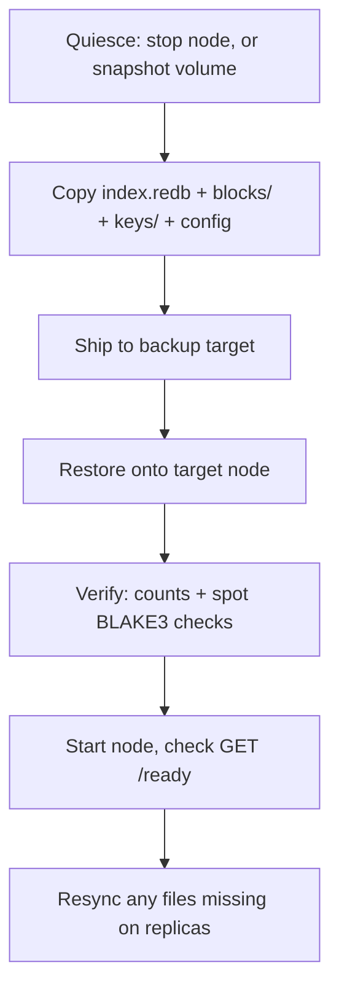
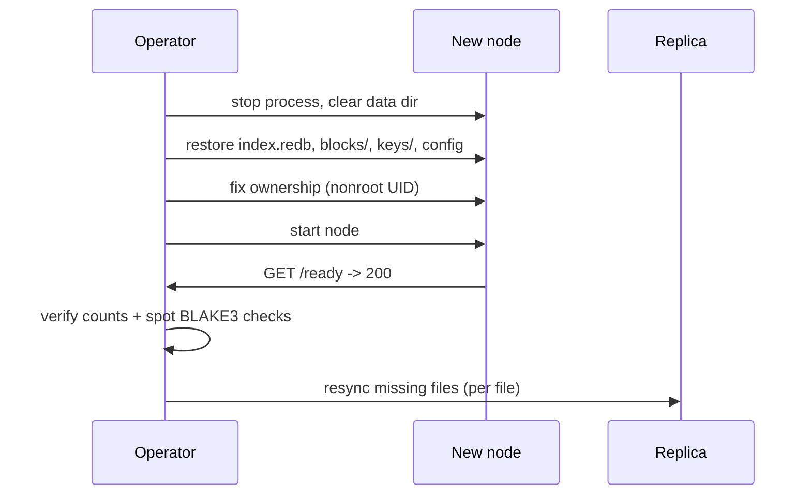

<!-- title: Backup & Restore category: operations audience: operator last_updated: 2026-11-10 -->

# Backup & Restore

A `file-storage` node keeps all durable state in three places on disk: the redb index file, the block-store directory and (when encryption is on) the per-tenant key files. This page defines what to copy, how to get a consistent copy, how to restore and verify, and what is genuinely not recoverable. For day-to-day disk and GC questions see [GC Operations](./gc-operations.md); for replica-side recovery see [Replication Ops](./replication-ops.md).

## Overview

With the default configuration (`storage.root data/blocks`, `storage.temp_dir data/tmp`, `database.path data/index.redb`) the state to protect is:

| Artifact | Path | Why |
|---|---|---|
| redb index file | `database.path` (e.g. `data/index.redb`) | Manifests, chunk refcounts, name/tag index, **audit log**, tenants — the single source of truth |
| Block store | `storage.root` (e.g. `data/blocks/`) | Content-addressed blobs `ab/cd/<64-hex>.bin` |
| Encryption keys | `encryption.keys_dir` (e.g. `data/keys/`) | Per-tenant AES-256-GCM keys, mode `0600`; without them encrypted blobs are undecryptable |
| Config and secrets | `config/*.yaml`, `auth.jwt_secret`, user hashes | Needed to boot a compatible replacement node |

Back up the temp directory never — `storage.temp_dir` holds multipart spool files mid-upload only.

## How it works

The write path makes backups forgiving. Blobs are fsynced **before** the single redb transaction that references them, and the transaction commits with `Durability::Immediate` (WAL + fsync). A copy taken at any instant is therefore crash-consistent in the useful direction:

```text
crash-consistent copy states
  blob present, index entry present   -> fine
  blob present, no index entry        -> orphan; GC sweeps after orphan_min_age_secs
  index entry, blob missing           -> impossible by write ordering
```

You never need to coordinate blob and index copies at the byte level; you need both sides of *one* point in time. That is what the procedures below guarantee.



*Figure 1: Backup and restore pipeline; verification is a scripted loop, not a built-in feature.*

## Usage

### Consistent-copy procedure

Pick one of these, in order of preference:

1. **Volume snapshot (best).** LVM, ZFS or EBS snapshots are atomic and need no downtime. Snapshot once; then copy the snapshot contents at leisure:
   ```bash
   lvcreate --snapshot -n fs-backup -L 10G /dev/vg0/fs-data
   # or on ZFS: zfs snapshot tank/fs-data@nightly
   # or on AWS: create an EBS snapshot of the data volume
   ```
2. **Quiesce, then copy.** Stop the process (`systemctl stop file-storage` or `docker compose stop primary`) or block writes at the firewall, run the copy, start again.
3. **fsfreeze.** On a plain filesystem without snapshot support, freeze the mount point during the copy:
   ```bash
   fsfreeze --freeze /var/lib/file-storage/data
   rsync ... ; fsfreeze --unfreeze /var/lib/file-storage/data
   ```

### rsync example

Use hardlink-aware, identity-preserving flags:

```bash
rsync -aHAX --numeric-ids --delete \
  /var/lib/file-storage/data/ \
  backup:/srv/backups/fs-primary/data/
```

`-H` preserves hardlinks (rare in the block store but safe), `-A`/`-X` keep ACLs and extended attributes, `--numeric-ids` keeps UID/GID mapping stable — the container runs as nonroot and the data directory must be writable by that UID after restore.

### Restore procedure



*Figure 2: Restore sequence; resync closes the async replication gap.*

Step by step:

1. Stop the target node and empty its data directory.
2. Restore `database.path`, `storage.root`, `encryption.keys_dir` and the config file with identical relative layout.
3. Fix ownership to the service UID (in the distroless container: UID 65532).
4. Start the node and confirm `GET /ready` returns 200 (`{"status":"ok","database":"ok","storage":"ok"}`).
5. Run the verification loop below — compare blob count against index entries and spot-check BLAKE3 hashes. There is no built-in verification job; write your own loop like this:
   ```bash
   #!/usr/bin/env bash
   set -euo pipefail
   BASE=http://localhost:8080/api/v1
   TOKEN=$(curl -s -X POST "$BASE/auth/login" -H 'Content-Type: application/json' \
     -d '{"username":"admin","password":"admin123"}' | jq -r .access_token)

   TOTAL=$(curl -s -H "Authorization: Bearer $TOKEN" "$BASE/files?limit=1" | jq .total)
   BLOBS=$(find /var/lib/file-storage/data/blocks -type f | wc -l)
   echo "index files=$TOTAL  blobs=$BLOBS  (blobs <= distinct chunks: dedup shares blobs)"

   for id in $(curl -s -H "Authorization: Bearer $TOKEN" "$BASE/files?limit=20" | jq -r '.items[].file_id'); do
     WANT=$(curl -s -D- -o /tmp/body.bin -H "Authorization: Bearer $TOKEN" "$BASE/files/$id" \
       | tr -d '\r' | awk 'tolower($1)=="x-content-hash:"{print $2}')
     GOT=$(b3sum /tmp/body.bin | cut -d' ' -f1)
     [ "$WANT" = "$GOT" ] || echo "MISMATCH $id want=$WANT got=$GOT"
   done
   ```
6. If a replica exists, compare listings (`GET /api/v1/files` on both) and push missing files with `POST /api/v1/admin/resync/:id`.

### Restore-to-replica trick

To validate a backup without touching production, restore it onto a node configured as a *replica*: set `replication.upstream_url` to the primary, leave `replication.enabled=false`, and set `retention.gc_mode=reachability`. Missing blobs arrive on demand during reads; missing manifests can be pulled per file with `POST /api/v1/admin/resync/:id` from the primary. A healthy replica can later be promoted by repointing clients at it.

### Audit backup

The audit log lives in the redb `audit` table, inside `database.path` — copying the index file backs up the audit trail automatically. To review it after a restore, `GET /api/v1/audit?limit=` (admin) returns the newest entries.

## Configuration

RPO/RTO guidance for the strategies above (values are guidance, not guarantees — measure on your hardware):

| Strategy | RPO | RTO | Notes |
|---|---|---|---|
| Sync replication + volume snapshot | ~0 for acknowledged uploads | minutes | Sync mode adds upload latency (`sync_timeout_ms`) |
| Async replication + snapshot | seconds to minutes (un-flushed queue window) | minutes | See below: the queue itself is not recoverable |
| Snapshot only | one snapshot interval | minutes | Second copy of a single-node deployment |
| Quiesced rsync | one copy interval | minutes | Requires a write pause |

## Examples

What is **not** recoverable, stated honestly:

- **In-memory replication queue (async mode).** Ops not yet flushed when the primary crashes are lost. The replica misses those files' manifests; repair with `POST /api/v1/admin/resync/:id` per file, or re-seed as described in [Replication Ops](./replication-ops.md). Sync mode closes the window at the cost of upload latency.
- **Refresh tokens.** They live in process memory (rotating, single-use, TTL 7d). After a restore every session is gone and users simply log in again; access tokens are stateless JWTs and expire within `auth.access_ttl_secs`.
- **Files uploaded after the last snapshot**, obviously — size your snapshot interval against how much loss is acceptable.

## See also

- [Replication Ops](./replication-ops.md) — replica repair, re-seeding and promotion.
- [GC Operations](./gc-operations.md) — orphan sweeping that makes crash-consistent copies clean themselves.
- [Runbook](./runbook.md) — incident procedures including corruption and key rotation.
- [Configuration reference](../configuration/reference.md) — paths, retention and replication keys.
- [Monitoring](./monitoring.md) — alerting on replication lag so backups and replicas agree.
