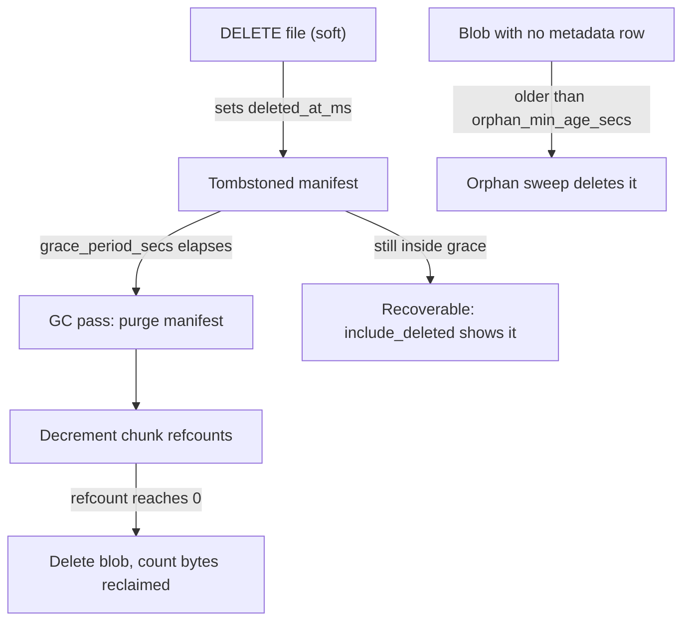

<!-- title: GC Operations category: operations audience: operator last_updated: 2026-11-10 -->

# GC Operations

Garbage collection reclaims space from soft-deleted files and orphaned blobs. On primaries the collector runs in `refcount` mode every `retention.gc_interval_secs` (default 300 s); on replicas it runs in `reachability` mode. This page explains when GC runs, how to trigger it manually, how to monitor reclamation lag and how to free disk in an emergency. The internal mechanics are covered in [GC architecture](../architecture/gc.md).

## Overview

Deletes are tombstones: `DELETE /api/v1/files/:id` sets `deleted_at_ms` on the manifest and returns 204 immediately. Space comes back only when a GC pass, running after the grace period, removes the manifest, decrements chunk refcounts and deletes blobs whose refcount reaches zero. The same pass sweeps on-disk orphans — blobs with no metadata row, older than `orphan_min_age_secs`.



*Figure 1: Tombstone lifecycle in refcount mode; the orphan sweep runs in the same pass.*

## How it works

A single background task ticks every `gc_interval_secs` and runs one pass in the configured mode. Each pass processes at most **5000** manifests/orphans; a large backlog therefore drains over several ticks. Results are logged (`background gc pass` with the report) and exported as counters (`gc_files_purged_total`, `gc_bytes_reclaimed_total`, `gc_orphans_removed_total`).

| Mode | Where | What it does |
|---|---|---|
| `refcount` | Primary | Purges soft-deleted manifests past the grace period, decrements refcounts, deletes zero-refcount blobs, sweeps index-orphans |
| `reachability` | Replica | Purges expired tombstones, then deletes blobs not referenced by any live manifest (and older than `orphan_min_age_secs`) |
| `disabled` | Either | Collector idle; space never reclaimed until you re-enable |

Two details worth knowing:

- **Orphan age guard.** The pipeline writes blobs before the index transaction, so a crash can leave a freshly written blob with no metadata. The sweeper skips anything younger than `orphan_min_age_secs` (default 3600) so it never deletes a blob that is mid-write.
- **Dedup interplay.** A blob is deleted only when its refcount reaches zero *across all files*. A chunk shared between a live file and a soft-deleted one stays until the live copy is also gone. `bytes_reclaimed` therefore often trails `manifests_purged`.

## Usage

### Manual trigger (REST)

```bash
TOKEN=$(curl -s -X POST localhost:8080/api/v1/auth/login \
  -H 'Content-Type: application/json' \
  -d '{"username":"admin","password":"admin123"}' | jq -r .access_token)

curl -s -X POST -H "Authorization: Bearer $TOKEN" localhost:8080/api/v1/admin/gc | jq
```

Response shape:

```json
{"manifests_purged": 3, "chunks_removed": 41, "orphans_removed": 0, "bytes_reclaimed": 57344}
```

The call runs one pass synchronously and is admin-only; it is safe to call concurrently with traffic.

### Manual trigger (gRPC)

```bash
# mode: 0 = MODE_UNSPECIFIED (use configured mode), 1 = REFCOUNT, 2 = REACHABILITY
grpcurl -plaintext -H "authorization: Bearer $TOKEN" -d '{"mode": 1}' \
  localhost:9090 file_storage.v1.AdminService/TriggerGC
```

`dry_run: true` is **not supported**: the server answers `UNIMPLEMENTED` (`gc dry_run is not supported yet; run without dry_run`) rather than silently running a destructive pass the caller believed was a rehearsal. Do not build tooling around `dry_run`.

### Monitoring GC lag

Tombstones inside the grace period are still queryable — that count *is* your GC backlog:

```bash
# Admin token required: include_deleted is admin-only.
curl -s -H "Authorization: Bearer $ADMIN" \
  'localhost:8080/api/v1/files?include_deleted=true&limit=1000' \
  | jq '[.items[] | select(.deleted)] | length'
```

Watch the metrics too: `gc_bytes_reclaimed_total` flat while free disk space falls means the collector is not reclaiming — usually because tombstones are still inside `grace_period_secs`, or `retention.gc_mode` is `disabled`. Both are covered by the `FileStorageGcStalled` alert in [Monitoring](./monitoring.md).

## Configuration

| Key | Default | Trade-off |
|---|---|---|
| `retention.gc_mode` | `refcount` | `reachability` on replicas; `disabled` only for controlled migrations |
| `retention.grace_period_secs` | 86400 | Shorter = faster reclaim, less undo window for accidental deletes; longer = more headroom |
| `retention.gc_interval_secs` | 300 | Lower drains a backlog faster; each pass is bounded to 5000 items anyway |
| `retention.orphan_min_age_secs` | 3600 | Must comfortably exceed upload write duration; too small risks deleting a mid-write blob |

No hot reload: changing any retention key requires a restart (env override, e.g. `FS_RETENTION__GRACE_PERIOD_SECS=300`).

## Examples

### Freeing disk in an emergency

1. Trigger a pass immediately — purges only tombstones already past grace:
   ```bash
   curl -s -X POST -H "Authorization: Bearer $ADMIN" localhost:8080/api/v1/admin/gc | jq
   ```
2. Shorten the grace period and restart so new tombstones purge quickly:
   ```bash
   FS_RETENTION__GRACE_PERIOD_SECS=300 file-storage --config /etc/file-storage/default.yaml
   # then trigger GC again; raise the value back after the incident
   ```
3. Purge specific files directly, skipping the grace window entirely (admin):
   ```bash
   curl -s -X DELETE -H "Authorization: Bearer $ADMIN" \
     'localhost:8080/api/v1/files/<file_id>?purge=true'
   ```
   Note `?purge=true` removes that manifest immediately; its zero-refcount blobs are deleted in the next GC pass (or immediately by the purge path where possible).
4. Expand the volume if reclaim cannot keep pace — GC frees *unreferenced* space, never live data.

### Gotchas

- **Dedup delays reclaim.** With content-defined chunking, overwritten files share most chunks with their predecessors. Re-uploading `report.pdf` ten times leaves nine tombstoned manifests whose unique chunks vanish only after grace + GC; shared chunks vanish only when no live file references them.
- **Replica modes differ.** A replica in `reachability` mode decides by "referenced by any live manifest", not refcounts — do not copy primary GC expectations onto it.
- **Empty files and tiny files** below `compression.min_size` store raw blobs; reclaim arithmetic (`bytes_reclaimed`) reflects stored size, not original size.

## See also

- [GC architecture](../architecture/gc.md) — collector internals and write ordering.
- [Monitoring](./monitoring.md) — GC metrics and the stalled-GC alert.
- [Runbook](./runbook.md) — scenario 1: primary disk full.
- [Configuration reference](../configuration/reference.md) — full retention section.
- [Troubleshooting](./troubleshooting.md) — disk-full and redb issues.
