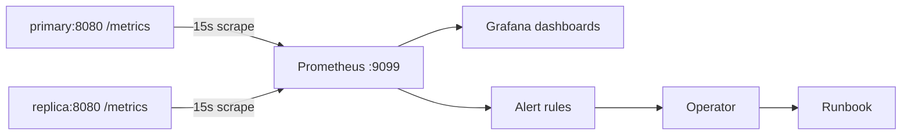

<!-- title: Monitoring category: operations audience: operator last_updated: 2026-11-10 -->

# Monitoring

All runtime metrics are exposed in Prometheus text format at `GET /metrics` on the REST port (default 8080); the bundled Compose stack ships Prometheus scraping both nodes every 15 seconds. This page is the metric catalog plus starter alert rules and a Grafana dashboard; when an alert fires, continue in the [Runbook](./runbook.md).

## Overview

Both listeners share one `AppState`, so one scrape target per node covers both transports. The Compose stack wires Prometheus like this:

```yaml
# config/prometheus.yml
global:
  scrape_interval: 15s
  evaluation_interval: 15s

scrape_configs:
  - job_name: file-storage-primary
    metrics_path: /metrics
    static_configs:
      - targets: ["primary:8080"]
  - job_name: file-storage-replica
    metrics_path: /metrics
    static_configs:
      - targets: ["replica:8080"]
```

The `prometheus` service in `docker-compose.yml` maps its UI to host port **9099** because host port 9090 already belongs to the primary's gRPC listener. Open `http://localhost:9099` after `docker compose up`.



*Figure 1: One scrape target per node covers REST and gRPC; alerts route into the runbook.*

## How it works

One global Prometheus recorder is installed per process (`src/metrics.rs`); all names are prefixed `file_storage_`. Two design decisions keep the series count predictable:

**Route-label normalization.** HTTP metrics label by *route template*, never by raw path: `normalize_path` rewrites any 36-character UUID segment to `:id` and any 64-hex segment to `:hash`:

```text
GET /api/v1/files/01930000-0000-7000-8000-00000000abcd   ->  route=/api/v1/files/:id
GET /internal/chunk/9f86d081884c7d659a2feaa0c55ad015...  ->  route=/internal/chunk/:hash
```

Per-file traffic cannot explode cardinality; the route set stays bounded no matter how many files exist.

**gRPC transport identification.** gRPC calls are recorded in their own families (`file_storage_grpc_requests_total`, `file_storage_grpc_request_duration_seconds`) with the full method path as the `rpc` label (for example `file_storage.v1.AuthService/Login`) and the gRPC status name as `code`. REST and gRPC traffic is distinguishable by metric family alone — no shared `transport` label is needed.

Histograms use the exporter's default buckets, so `histogram_quantile` works out of the box.

## Configuration

No metric-specific configuration exists; `GET /metrics` is always on. The catalog:

| Metric | Type | Labels | Meaning |
|---|---|---|---|
| `file_storage_uploads_total` | counter | `status` | Completed uploads |
| `file_storage_downloads_total` | counter | `status`, `source` | Completed downloads; `source` is `l1`, `l2`, `disk` or `mixed` |
| `file_storage_upload_duration_seconds` | histogram | `status` | End-to-end upload latency |
| `file_storage_download_duration_seconds` | histogram | `status` | End-to-end download latency |
| `file_storage_bytes_written_total` | counter | — | Original (logical) bytes accepted |
| `file_storage_bytes_read_total` | counter | — | Plaintext bytes served |
| `file_storage_dedup_hits_total` | counter | — | Chunks resolved from an already-stored blob |
| `file_storage_dedup_bytes_saved_total` | counter | — | Bytes not written because of dedup |
| `file_storage_cache_hits_total` | counter | `level` | Cache hits per level (`l1` plaintext, `l2` blobs, `l3` manifests) |
| `file_storage_chunks_stored_total` | counter | `deduped` | Chunks written to the block store |
| `file_storage_replication_queue_depth` | gauge | — | Ops waiting in the in-memory replication queue (capacity default 10000) |
| `file_storage_replication_failures_total` | counter | — | Failed replication flushes on the primary |
| `file_storage_replication_ops_applied_total` | counter | — | Replication ops applied by the replica |
| `file_storage_replication_flush_seconds` | histogram | `status` | Flush duration; status records success or failure |
| `file_storage_hash_mismatch_total` | counter | — | BLAKE3 verification failures after disk loads (data corruption signal) |
| `file_storage_gc_files_purged_total` | counter | — | Manifests purged by garbage collection |
| `file_storage_gc_bytes_reclaimed_total` | counter | — | Bytes freed by garbage collection |
| `file_storage_gc_orphans_removed_total` | counter | — | Orphan blobs swept |
| `file_storage_http_request_duration_seconds` | histogram | `method`, `route` | HTTP latency by normalized route |
| `file_storage_http_requests_total` | counter | `method`, `route`, `status` | HTTP requests with status class |
| `file_storage_grpc_request_duration_seconds` | histogram | `rpc`, `code` | gRPC latency by method path |
| `file_storage_grpc_requests_total` | counter | `rpc`, `code` | gRPC calls; `code` is the status name (`ok` on success) |
| `file_storage_audit_events_total` | counter | `action` | Audit events appended, by action |
| `file_storage_uptime_seconds` | gauge | — | Process uptime |

## Usage

### Suggested alert rules

A practical starter set — only `hash_mismatch` should page immediately:

```yaml
groups:
  - name: file-storage
    rules:
      - alert: FileStorageScrapeDown
        expr: up{job=~"file-storage-.*"} == 0
        for: 1m
        labels:
          severity: critical

      - alert: FileStorageNotReady
        # GET /ready returns 503 while the redb ping or storage-root probe
        # fails. Point a blackbox exporter (or your HTTP prober) at /ready.
        expr: probe_success{job="file-storage-ready"} == 0
        for: 2m
        labels:
          severity: critical
        annotations:
          summary: "Node not ready (database/storage probe failing)"

      - alert: FileStorageReplicationFailing
        expr: increase(file_storage_replication_failures_total[5m]) > 0
        for: 5m
        labels:
          severity: warning

      - alert: FileStorageReplicationQueueBacklog
        expr: file_storage_replication_queue_depth > 8000
        for: 5m
        labels:
          severity: warning

      - alert: FileStorageGcStalled
        # Requires node_exporter for filesystem metrics.
        expr: |
          rate(file_storage_gc_bytes_reclaimed_total[6h]) == 0
          and node_filesystem_avail_bytes{mountpoint="/var/lib/file-storage"}
              / node_filesystem_size_bytes{mountpoint="/var/lib/file-storage"} < 0.15
        for: 30m
        labels:
          severity: warning
        annotations:
          summary: "Disk filling while GC reclaims nothing (grace pending?)"

      - alert: FileStorageHashMismatch
        expr: increase(file_storage_hash_mismatch_total[5m]) > 0
        labels:
          severity: critical
        annotations:
          summary: "BLAKE3 verification failed — possible corruption, page now"

      - alert: FileStorageUploadP99Regression
        expr: |
          histogram_quantile(0.99,
            sum by (le) (rate(file_storage_upload_duration_seconds_bucket[5m]))) > 5
        for: 10m
        labels:
          severity: warning

      - alert: FileStorage5xxRate
        expr: |
          sum(rate(file_storage_http_requests_total{status=~"5.."}[5m]))
            / clamp_min(sum(rate(file_storage_http_requests_total[5m])), 0.001) > 0.01
        for: 10m
        labels:
          severity: warning
```

### Grafana dashboard

Import this minimal dashboard (schemaVersion 36) covering throughput, dedup, cache hit rate by level, replication lag, GC reclaim, gRPC RPS by method and error rate:

```json
{
  "title": "file-storage",
  "uid": "file-storage-overview",
  "schemaVersion": 36,
  "editable": true,
  "time": { "from": "now-6h", "to": "now" },
  "panels": [
    {
      "id": 1, "type": "timeseries", "title": "Upload throughput",
      "datasource": { "type": "prometheus", "uid": "${DS_PROMETHEUS}" },
      "gridPos": { "x": 0, "y": 0, "w": 12, "h": 8 },
      "fieldConfig": { "defaults": { "unit": "Bps" }, "overrides": [] },
      "options": { "legend": { "displayMode": "list", "placement": "bottom" } },
      "targets": [ { "refId": "A", "expr": "sum(rate(file_storage_bytes_written_total[1m]))", "legendFormat": "written" } ]
    },
    {
      "id": 2, "type": "timeseries", "title": "Download throughput",
      "datasource": { "type": "prometheus", "uid": "${DS_PROMETHEUS}" },
      "gridPos": { "x": 12, "y": 0, "w": 12, "h": 8 },
      "fieldConfig": { "defaults": { "unit": "Bps" }, "overrides": [] },
      "options": { "legend": { "displayMode": "list", "placement": "bottom" } },
      "targets": [ { "refId": "A", "expr": "sum(rate(file_storage_bytes_read_total[1m]))", "legendFormat": "read" } ]
    },
    {
      "id": 3, "type": "timeseries", "title": "Dedup savings ratio",
      "datasource": { "type": "prometheus", "uid": "${DS_PROMETHEUS}" },
      "gridPos": { "x": 0, "y": 8, "w": 12, "h": 8 },
      "fieldConfig": { "defaults": { "unit": "percent", "max": 100 }, "overrides": [] },
      "options": { "legend": { "displayMode": "list", "placement": "bottom" } },
      "targets": [ { "refId": "A", "expr": "100 * sum(rate(file_storage_dedup_bytes_saved_total[5m])) / clamp_min(sum(rate(file_storage_bytes_written_total[5m])) + sum(rate(file_storage_dedup_bytes_saved_total[5m])), 1)", "legendFormat": "saved %" } ]
    },
    {
      "id": 4, "type": "timeseries", "title": "Cache hits by level",
      "datasource": { "type": "prometheus", "uid": "${DS_PROMETHEUS}" },
      "gridPos": { "x": 12, "y": 8, "w": 12, "h": 8 },
      "fieldConfig": { "defaults": { "unit": "ops" }, "overrides": [] },
      "options": { "legend": { "displayMode": "list", "placement": "bottom" } },
      "targets": [ { "refId": "A", "expr": "sum by (level) (rate(file_storage_cache_hits_total[5m]))", "legendFormat": "{{level}}" } ]
    },
    {
      "id": 5, "type": "timeseries", "title": "Replication queue depth (lag)",
      "datasource": { "type": "prometheus", "uid": "${DS_PROMETHEUS}" },
      "gridPos": { "x": 0, "y": 16, "w": 12, "h": 8 },
      "fieldConfig": { "defaults": { "unit": "short" }, "overrides": [] },
      "options": { "legend": { "displayMode": "list", "placement": "bottom" } },
      "targets": [ { "refId": "A", "expr": "file_storage_replication_queue_depth", "legendFormat": "{{job}}" } ]
    },
    {
      "id": 6, "type": "timeseries", "title": "GC bytes reclaimed",
      "datasource": { "type": "prometheus", "uid": "${DS_PROMETHEUS}" },
      "gridPos": { "x": 12, "y": 16, "w": 12, "h": 8 },
      "fieldConfig": { "defaults": { "unit": "Bps" }, "overrides": [] },
      "options": { "legend": { "displayMode": "list", "placement": "bottom" } },
      "targets": [ { "refId": "A", "expr": "sum(rate(file_storage_gc_bytes_reclaimed_total[10m]))", "legendFormat": "reclaimed" } ]
    },
    {
      "id": 7, "type": "timeseries", "title": "gRPC RPS by method",
      "datasource": { "type": "prometheus", "uid": "${DS_PROMETHEUS}" },
      "gridPos": { "x": 0, "y": 24, "w": 12, "h": 8 },
      "fieldConfig": { "defaults": { "unit": "reqps" }, "overrides": [] },
      "options": { "legend": { "displayMode": "list", "placement": "bottom" } },
      "targets": [ { "refId": "A", "expr": "sum by (rpc) (rate(file_storage_grpc_requests_total[1m]))", "legendFormat": "{{rpc}}" } ]
    },
    {
      "id": 8, "type": "timeseries", "title": "Error rate (HTTP 5xx)",
      "datasource": { "type": "prometheus", "uid": "${DS_PROMETHEUS}" },
      "gridPos": { "x": 12, "y": 24, "w": 12, "h": 8 },
      "fieldConfig": { "defaults": { "unit": "reqps" }, "overrides": [] },
      "options": { "legend": { "displayMode": "list", "placement": "bottom" } },
      "targets": [ { "refId": "A", "expr": "sum(rate(file_storage_http_requests_total{status=~\"5..\"}[5m]))", "legendFormat": "5xx" } ]
    }
  ]
}
```

## Examples

Two quick queries worth pinning:

```bash
# Dedup hit ratio per chunk written
curl -s localhost:8080/metrics | grep -E 'file_storage_(dedup_hits|chunks_stored)_total'
# Replica lag: depth should hover near 0
curl -s localhost:8081/metrics | grep replication_queue_depth
```

## See also

- [Runbook](./runbook.md) — response procedures for the alerts above.
- [Troubleshooting](./troubleshooting.md) — symptom-level diagnosis.
- [GC Operations](./gc-operations.md) and [Replication Ops](./replication-ops.md) — what drives the `gc_*` and `replication_*` series.
- [Configuration reference](../configuration/reference.md) — every tunable behind these numbers.
- [Benchmarks](../performance/benchmarks.md) — expected throughput baselines.
