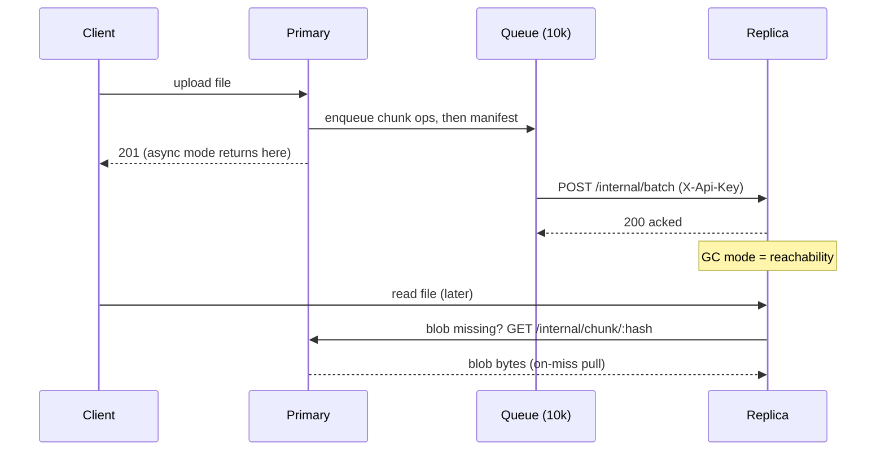

<!-- title: Replication Ops category: operations audience: operator last_updated: 2026-11-10 -->

# Replication Ops

Replication is an async WAL shipper: the primary queues chunk blobs and manifests into a bounded in-memory queue and drains them in batches to a replica, which can also pull missing blobs on demand. This page covers the operational side — health signals, lag monitoring, the three repair procedures, key rotation and partition behaviour. Architecture and op ordering are in [Replication architecture](../architecture/replication.md); monitoring data sources are in [Monitoring](./monitoring.md).

## Overview

A deployment is primary + replica. The primary sets `replication.enabled=true`, `replication.target_url` and a shared `replication.api_key`; the replica stays disabled but points `replication.upstream_url` at the primary for pull-based repair. Ops are queued (capacity `queue_capacity`, default 10000) and flushed in batches of `batch_size` (64) or every `flush_interval_ms` (5000). Order is preserved per file: chunk blobs first, then the manifest, so a manifest never arrives before its blobs.



*Figure 1: Ship-and-ack pipeline with the replica's on-miss pull repair path.*

## How it works

### Health signals

| Signal | Type | Healthy | Meaning |
|---|---|---|---|
| `replication_queue_depth` | gauge | ~0 | Ops waiting to ship; growth = lag |
| `replication_failures_total` | counter | flat | Failed flush attempts; increases during target outages |
| `replication_flush_seconds` | histogram | stable | Flush duration per batch, tagged by outcome |
| `replication_ops_applied_total` | counter (replica) | rising | Ops the replica has applied |

### Lag monitoring

Queue depth is the primary lag signal. Cross-check it with content: compare file counts between nodes via their listings — `GET /api/v1/files?limit=1` returns `total`; a growing difference is lag the queue has not yet shipped, a *permanent* difference means failed or lost ops (the in-memory queue is lost on primary restart).

```bash
curl -s -H "Authorization: Bearer $T" 'http://primary:8080/api/v1/files?limit=1' | jq .total
curl -s -H "Authorization: Bearer $T" 'http://replica:8081/api/v1/files?limit=1' | jq .total
```

### Network partition behaviour

On flush failure the worker backs off exponentially — 100 ms, then 500 ms, then 2 s (held) — and retries the same batch. Uploads keep succeeding in async mode until the queue is full; at capacity, `send` awaits a slot, so uploads slow down as natural backpressure (they do not error). In sync mode a blocked flush fails the upload after `sync_timeout_ms` (default 5000) with HTTP 503 (`service_unavailable`). When the partition heals, the queue drains without operator action.

## Usage

### Repair procedure 1 — automatic on-miss pull

For reads: if a blob is missing on the replica (its `storage.root`), the read path fetches it from `replication.upstream_url`, stores it and serves the data. Requires nothing but `upstream_url` + matching `api_key`. This repairs *blobs*, not missing manifests.

### Repair procedure 2 — admin resync per file

Push a complete file bundle (manifest + all chunk blobs) to the replica, bypassing the queue:

```bash
curl -s -X POST -H "Authorization: Bearer $ADMIN" \
  http://primary:8080/api/v1/admin/resync/<file_id> | jq
# {"file_id": "...", "replicated": true}
```

Equivalent gRPC: `AdminService/Resync` with `{"file_id": "..."}` returning `{file_id, replicated}`.

### Repair procedure 3 — re-seed a fresh replica

A new (or badly damaged) replica starts with an empty data dir; the primary ships everything file by file:

```bash
#!/usr/bin/env bash
# Re-seed a fresh replica from the primary's listing. Paginate for >1000 files.
ADMIN=$(curl -s -X POST http://primary:8080/api/v1/auth/login \
  -H 'Content-Type: application/json' \
  -d '{"username":"admin","password":"admin123"}' | jq -r .access_token)

for id in $(curl -s -H "Authorization: Bearer $ADMIN" \
    'http://primary:8080/api/v1/files?limit=1000' | jq -r '.items[].file_id'); do
  curl -s -X POST -H "Authorization: Bearer $ADMIN" \
    "http://primary:8080/api/v1/admin/resync/$id" | jq -c .
done
```

Loop with `offset` until `total` files are covered. Verify with the listing comparison above.

### gRPC ReplicationService as an ingestion path

The internal gRPC service (guarded by `x-api-key` metadata) is a documented alternative for seeding or migrating between clusters:

| RPC | Direction | Purpose |
|---|---|---|
| `ReplicateBatch` | client-streaming | Ship `ReplicationOp`s (`put_chunk` / `put_manifest` / `delete_file` / `flush`), receive `ReplicationAck{ops_acked, success, error}` |
| `PullChunk` | server-streaming | Fetch one raw blob by its 32-byte hash (repair path) |
| `PullManifest` | unary | Fetch a `ManifestBundle` for one file |

```bash
grpcurl -plaintext -H "x-api-key: cluster-api-key-change-me" \
  -d '{"file_id": "01930000-0000-7000-8000-00000000abcd"}' \
  localhost:9090 file_storage.v1.ReplicationService/PullManifest
```

### api_key rotation

The key is read at boot and must match on both nodes. There is no dual-key acceptance window, so rotate by restart, replica first:

1. Set the new `FS_REPLICATION__API_KEY` on the **replica** and restart it. Replication flushes fail during the mismatch window; the queue absorbs them.
2. Set the new key on the **primary** and restart it. The un-flushed queue is lost at restart — run repair procedure 3 (or per-file resync) for anything uploaded since step 1.
3. Watch `replication_failures_total` return to flat and queue depth to ~0.

## Configuration

| Key | Default | Trade-off |
|---|---|---|
| `replication.mode` | `async` | `sync` blocks uploads until the batch acks — ~0 RPO, higher latency; async has a crash window |
| `replication.sync_timeout_ms` | 5000 | Sync-mode failure budget per upload |
| `replication.batch_size` | 64 | Larger batches amortise round trips; smaller batches lower per-file lag |
| `replication.flush_interval_ms` | 5000 | Lower = tighter lag, more small batches; the linger window before a partial batch flushes |
| `replication.queue_capacity` | 10000 | Backpressure ceiling; raise only with memory headroom |
| `replication.api_key` | — | Shared cluster secret; rotate via restart |

### Consistent snapshot restore from a replica

The replica holds every acknowledged file, so its volume is a live restore point: take a volume snapshot of the replica (see [Backup & Restore](./backup-restore.md)), or promote the replica itself by repointing clients, then resync files the old primary had not yet shipped. After promotion, re-seed a fresh primary and flip roles.

## Examples

Interpretation notes: `PullChunk` streams ≤64 KiB pieces, so bulk repairs via gRPC should aggregate client-side; `ReplicateBatch` acks per batch with `success=false` plus `error` text when a batch is rejected (check `api_key` first). For alert wiring — queue depth above 80% of capacity, failures increasing — see the rules in [Monitoring](./monitoring.md).

## See also

- [Replication architecture](../architecture/replication.md) — queue, batching and ordering internals.
- [Monitoring](./monitoring.md) — replication metrics and alerts.
- [Backup & Restore](./backup-restore.md) — snapshots, RPO/RTO and the async queue caveat.
- [Runbook](./runbook.md) — scenario 2: replica lag growing.
- [Configuration reference](../configuration/reference.md) — the replication section in full.
