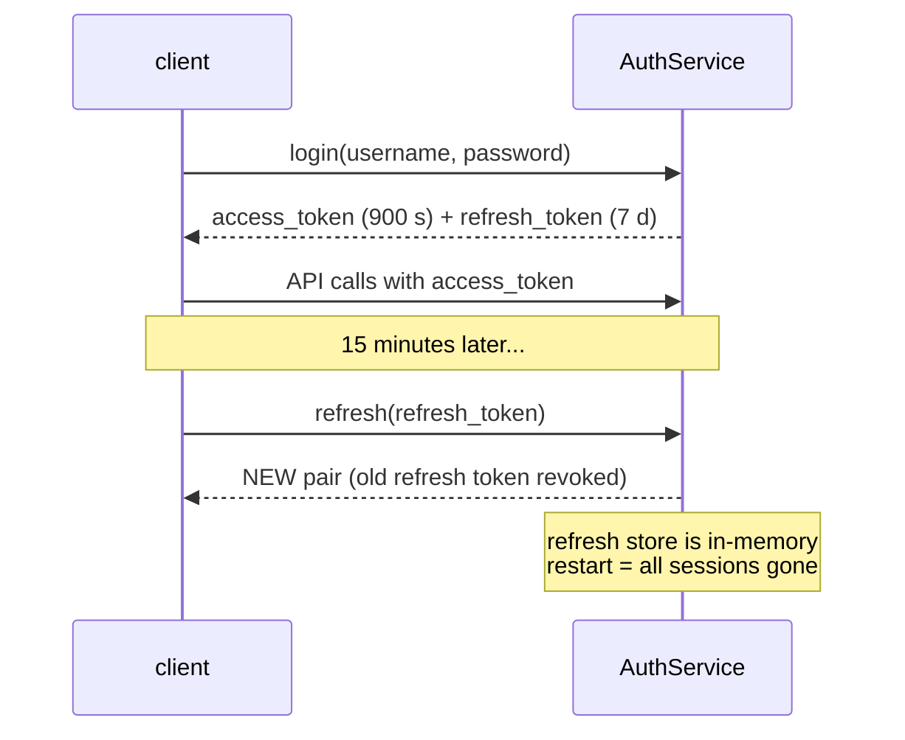

<!-- title: Authentication category: security audience: developer|security-engineer|operator last_updated: 2026-11-10 -->

# Authentication

file-storage authenticates users with a login call and issues an HS256 JWT access token plus an opaque rotating refresh token. This page documents the token format, the lifecycle rules, how to present tokens on both transports, and the exact role matrix. The API-facing view of the same material lives in the [REST API](../api/rest.md) and [gRPC API](../api/grpc.md) references.

## Overview

Users are defined statically in configuration (`auth.users`). A successful login returns an access token (default TTL **900 seconds**) and a refresh token (default TTL **7 days**). Access tokens are self-contained HS256 JWTs verified in-process on every request; refresh tokens are single-use: each refresh revokes the presented token and issues a new pair (rotation). Three roles — `admin`, `user`, `viewer` — gate every operation, and every request is scoped to the tenant embedded in the token.

## How it works

### Token internals

The access token is signed with `auth.jwt_secret` using HS256 and carries exactly these claims:

```json
{
  "sub": "alice",
  "tenant": "01930000-0000-7000-8000-000000000002",
  "role": "user",
  "iat": 1762700000,
  "exp": 1762700900,
  "jti": "01930000-0000-7000-8000-0000000000cd"
}
```

| Claim | Meaning |
|---|---|
| `sub` | Username; becomes the audit actor |
| `tenant` | Tenant UUID; the hard scope for every operation |
| `role` | `admin`, `user` or `viewer` |
| `iat` / `exp` | Issued-at / expiry epoch seconds (default lifetime 900 s) |
| `jti` | Unique token ID (UUIDv7) |

Verification uses a **5-second clock leeway** for expiry. Because verification is purely local (HMAC), there is no revocation list for access tokens — a leaked access token is valid until `exp`. That is the reason for the short TTL.

### Access vs refresh lifecycle



*Figure 1: login issues a pair; each refresh rotates and revokes.*

Key properties:

- Refresh tokens are **single-use** — presenting a rotated token fails with 401.
- The refresh store is an **in-memory** map; a process restart loses every session. "Logout everywhere" is therefore: restart the service, or rotate `auth.jwt_secret` (which also invalidates all outstanding access tokens).
- Logout (`POST /auth/logout` with the refresh token) is **idempotent**: it returns 204 whether or not the token existed, and never fails.

### Transport differences

| | REST | gRPC |
|---|---|---|
| Where the JWT goes | `Authorization: Bearer <jwt>` header | `authorization: Bearer <jwt>` metadata |
| Login endpoint | `POST /api/v1/auth/login` | `file_storage.v1.AuthService/Login` |
| Enforcement | Auth middleware on `/api/v1` (except `/auth/*`) | Unary interceptors; streaming handlers verify the JWT in-handler |
| Health/metrics | `/health`, `/ready`, `/metrics` unauthenticated | `grpc.health.v1.Health` + reflection unauthenticated |

## Configuration

### Defining users

```yaml
auth:
  jwt_secret: "change-me-in-production-0123456789abcdef"  # >= 16 chars
  access_ttl_secs: 900
  refresh_ttl_secs: 604800
  users:
    - username: admin
      password_hash: "$argon2id$v=19$m=65536,t=3,p=4$..."   # preferred
      tenant_id: "01930000-0000-7000-8000-000000000001"
      role: admin
```

- `password_hash` (argon2id PHC string) is preferred in production. Generate one with `file-storage hash-password --password '...'`.
- `password` (plaintext) exists for development convenience only; it must not appear in production configuration.
- Each user maps to exactly one tenant and one role; cross-tenant access requires the `admin` role.
- Every login attempt is audited: `auth.login.success` and `auth.login.failure` events record the username and client IP (see [Audit Log](./audit.md)).
- Unknown usernames consume the same argon2 verification time as known ones (dummy hash), removing a timing side channel for username enumeration.

## Examples

### Role matrix

Every operation is gated by role; cross-tenant access is admin-only in all rows.

| Operation | admin | user | viewer |
|---|---|---|---|
| Upload (`POST /files`, `FileService/Upload`) | yes | yes | no |
| Download (`GET /files/:id`, `Download`) | yes | yes | yes |
| Metadata (`GET /files/:id/meta`, `GetManifest`) | yes | yes | yes |
| List (`GET /files`, `ListFiles`) | yes | yes | yes |
| Soft delete (`DELETE /files/:id`, `DeleteFile`) | yes | yes | no |
| Hard purge (`DELETE /files/:id?purge=true`) | yes | no | no |
| Tenants (`POST/GET /tenants`) | yes | no | no |
| GC trigger (`POST /admin/gc`) | yes | no | no |
| Audit query (`GET /audit`) | yes | no | no |
| Resync (`POST /admin/resync/:id`) | yes | no | no |

### gRPC login and use

```bash
JWT=$(grpcurl -plaintext -d '{"username":"admin","password":"admin123"}' \
  localhost:9090 file_storage.v1.AuthService/Login | jq -r .access_token)

grpcurl -plaintext -H "authorization: Bearer $JWT" \
  -d '{"limit": 10}' localhost:9090 file_storage.v1.FileService/ListFiles
```

The Rust SDK wraps this: `client.login("admin", "admin123").await?` stores the token and attaches it to subsequent calls automatically; `client.refresh()` and `client.logout()` follow the same rotation rules.

## See also

- [REST API](../api/rest.md) — request/response shapes for `/auth/*`.
- [gRPC API](../api/grpc.md) — service definitions and metadata.
- [Tenants](./tenants.md) — what the `tenant` claim actually scopes.
- [Audit Log](./audit.md) — how login events are recorded.
- [Configuration reference](../configuration/reference.md) — `auth.*` keys.
- [Hardening Checklist](./hardening.md) — secret rotation and least-privilege guidance.
